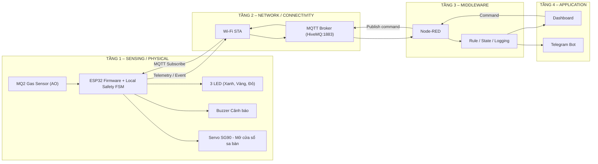

> [!IMPORTANT]
> **BẢN LƯU LỊCH SỬ — BASELINE V1.** Từ ngày 17/10/2026, danh sách linh kiện và logic actuator trong tài liệu này **không còn là thiết kế hiện hành**. GasCheck V2 dùng **MQ2 + ESP32 + 3 LED + buzzer + servo mở cửa sổ mini**, không dùng MQ135/quạt/relay/van gas mô phỏng. Xem **[Kiến trúc vật lý V2](../docs/KienTrucVatLy_GasCheck_V2.md)** và [README hiện hành](../README.md). Nội dung V1 dưới đây giữ nguyên để truy vết lịch sử dự án.

---

# 🛡️ TUẦN 1 — PHÂN TÍCH BÀI TOÁN & KIẾN TRÚC HỆ THỐNG IoT

> [← README](../README.md) · [📚 Danh sách báo cáo hằng tuần](../README.md#bao-cao-hang-tuan)

## Mục lục

- [1. Problem Statement – Phân tích bài toán](#section-1)
- [2. Actors và Use Cases](#section-2)
- [3. Yêu cầu hệ thống](#section-3)
- [4. Input – Processing – Output](#section-4)
- [5. Logic tự động V1](#section-5)
- [6. Kiến trúc IoT 4 tầng – Version 1](#section-6)
- [7. MQTT Topic Map – Draft V1](#section-7)
- [8. BOM dự kiến](#section-8)
- [9. Test Scenarios được định nghĩa từ Tuần 1](#section-9)
- [10. Phân công nhóm N19](#section-10)
- [11. Definition of Done – Tuần 1](#section-11)
---

## 0. Thông tin đề tài

| Thuộc tính | Nội dung |
|---|---|
| Nhóm | N19 |
| Mã đề tài | 6 |
| Tên đề tài | **Cảnh báo rò rỉ Gas & chất lượng không khí** |
| Nhóm ứng dụng | Safety |
| Thành viên | Trình Quốc An – Nguyễn Kim Long – Nguyễn Long Vỹ |
| Thời lượng | 10 tuần × 6 giờ/tuần/SV, tối thiểu 60 giờ/SV |
| Mục tiêu Tuần 1 | Phân tích bài toán, chốt phạm vi, xác định input/output và logic tự động, thiết kế kiến trúc IoT 4 tầng V2, BOM dự kiến và phân công nhóm |

> **Lưu ý an toàn:** Đây là hệ thống prototype/mô phỏng phục vụ học tập. MQ2, servo và mạch tự lắp **không phải hệ thống an toàn khí gas được chứng nhận** và không nên dùng để bảo vệ người/tài sản trên đường gas thật. **Đồ án thống nhất KHÔNG dùng van gas, KHÔNG dùng quạt thông gió và KHÔNG dùng relay**. Động cơ servo SG90 trong mô hình chỉ dùng để **mô phỏng mở cửa sổ mini sa bàn** nhằm tăng cường đối lưu thông thoáng không khí.

---

<a id="section-1"></a>
# 1. Problem Statement – Phân tích bài toán

## 1.1. Bối cảnh

Trong không gian kín như bếp, phòng trọ, phòng kỹ thuật hoặc khu vực có thiết bị sử dụng gas, rò rỉ khí gas/khói có thể gây cháy nổ hoặc ảnh hưởng sức khỏe. Điểm rò rỉ có thể xuất phát từ thân bình, cổ bình, ống dẫn mềm, khớp nối chứ không chỉ nằm sau van. Do đó, việc giả định đóng van là biện pháp toàn năng là không chính xác và thiếu an toàn.

Việc chỉ hiển thị giá trị cảm biến là chưa đủ. Hệ thống cần có khả năng **tự phản ứng tại thiết bị ngay khi phát hiện nguy hiểm** (bật còi, nhấp nháy đèn cảnh báo, mở cửa sổ thông thoáng), đồng thời truyền dữ liệu qua mạng để middleware xử lý, lưu log và gửi cảnh báo đến người dùng.

## 1.2. Vấn đề cần giải quyết

Hệ thống cần trả lời được 5 câu hỏi chính:

1. Không khí hiện tại có dấu hiệu gas/khói bất thường hay không?
2. Khi vượt ngưỡng, hệ thống có phản ứng tự động tại chỗ (bật còi, đổi LED, mở cửa sổ) mà không cần người dùng thao tác không?
3. Nếu Internet/MQTT bị mất, thiết bị có vẫn thực hiện phản ứng an toàn cục bộ không?
4. Người dùng có nhận được trạng thái/cảnh báo từ xa không?
5. Hệ thống có chứng minh được đầy đủ luồng IoT 4 tầng và luồng dữ liệu hai chiều không?

## 1.3. Mục tiêu tổng quát

Xây dựng hệ thống IoT mô phỏng có khả năng:

- giám sát tín hiệu gas/khói bằng MQ2 (nguồn analog giả lập qua potentiometer);
- xử lý dữ liệu và lọc nhiễu trên ESP32;
- phân định 3 mức trạng thái trực quan bằng 3 LED (Xanh, Vàng, Đỏ);
- tự động mở cửa sổ mini mô phỏng bằng servo SG90 và phát còi buzzer khi có nguy hiểm;
- truyền telemetry/event qua MQTT;
- dùng Node-RED làm middleware/automation engine;
- hiển thị trạng thái và gửi cảnh báo từ xa qua Telegram Bot hoặc dashboard;
- cho phép một số lệnh từ xa nhưng luôn bị ràng buộc bởi quy tắc an toàn (Safety Interlock) tại ESP32.

## 1.4. Phạm vi thực hiện

### Trong phạm vi

- Simulation là thành phần bắt buộc.
- Mô phỏng sensor/input và actuator/output.
- ESP32 đọc dữ liệu, xử lý trạng thái và điều khiển actuator.
- Kết nối Wi-Fi và MQTT.
- MQTT Broker và Node-RED.
- Dashboard/trạng thái và Telegram cảnh báo.
- Automation rule, state machine, log sự kiện.
- Uplink: Device → MQTT → Middleware → Application.
- Downlink: Application/Middleware → MQTT → Device → Actuator.
- Test tình huống bình thường, cảnh báo, mất mạng và phục hồi.

### Ngoài phạm vi Tuần 1

- Wiring hoàn chỉnh trên simulator: thực hiện Tuần 2.
- Calibration và chốt threshold thực tế: thực hiện Tuần 3.
- MQTT connection chạy thật: Tuần 4.
- Node-RED flow hoàn chỉnh: Tuần 5.
- Application hoàn chỉnh: Tuần 6.
- Hardware vật lý: tùy chọn/bonus, chỉ nên làm sau khi simulation ổn định.

## 1.5. Giả định thiết kế

- MQ2 và MQ135 được xem là nguồn dữ liệu analog biểu diễn mức khí/chất lượng không khí.
- Trong simulation, nếu simulator không có đúng module MQ2/MQ135 thì có thể dùng input analog tương đương để tạo tín hiệu và giải thích rõ mapping.
- Ngưỡng trong giai đoạn mô phỏng là **ngưỡng thử nghiệm**, không phải ngưỡng chứng nhận an toàn thực tế.
- Phản ứng nguy hiểm phải được thực hiện **cục bộ trên ESP32 trước**, không phụ thuộc Node-RED hay Telegram.

---

<a id="section-2"></a>
# 2. Actors và Use Cases

## 2.1. Actors

| Actor | Vai trò |
|---|---|
| Người dùng | Theo dõi trạng thái, nhận cảnh báo, xác nhận/reset hệ thống khi điều kiện an toàn |
| MQ2 | Cung cấp tín hiệu liên quan gas/khói |
| MQ135 | Cung cấp tín hiệu đại diện chất lượng không khí |
| ESP32 | Đọc sensor, xử lý logic local, điều khiển actuator, giao tiếp MQTT |
| MQTT Broker | Trung gian truyền message giữa device, middleware và application |
| Node-RED | Xử lý rule, log, cảnh báo, dashboard và command |
| Telegram Bot / Dashboard | Giao diện/application cho người dùng |

## 2.2. Danh sách Use Case

| ID | Use Case | Actor chính | Kết quả mong đợi |
|---|---|---|---|
| UC01 | Theo dõi nồng độ khí gas | ESP32, MQ2 | Đọc dữ liệu ADC định kỳ, lọc số và xác định trạng thái |
| UC02 | Xử lý rò rỉ gas tự động | ESP32 | Đổi LED Đỏ, bật còi buzzer, mở cửa sổ mini sa bàn (90°) |
| UC03 | Cảnh báo mức Warning sớm | ESP32 | Đổi LED Vàng, còi kêu ngắt quãng (300ms ON / 700ms OFF) |
| UC04 | Gửi telemetry định kỳ | ESP32 | Publish dữ liệu lên MQTT topic telemetry mỗi 2s |
| UC05 | Gửi cảnh báo khẩn | Node-RED | Gửi message cảnh báo khi trạng thái chuyển sang nguy hiểm |
| UC06 | Xem trạng thái từ xa | Người dùng | Xem sensor/state/actuator trên Dashboard hoặc Telegram |
| UC07 | Gửi command từ xa | Người dùng | Lệnh Reset/Test còi được Node-RED publish xuống ESP32 |
| UC08 | Khôi phục sau cảnh báo | Người dùng + ESP32 | Chỉ cho reset đóng cửa sổ khi gas đã trở lại ngưỡng an toàn (<1300) |
| UC09 | Xử lý mất mạng | ESP32 | Cảnh báo còi, LED và mở cửa sổ cục bộ vẫn chạy 100% |

## 2.3. Use Case quan trọng – UC02: Phát hiện gas nguy hiểm

**Tiền điều kiện:** ESP32 đang hoạt động và MQ2 có dữ liệu hợp lệ.

**Luồng chính:**

1. ESP32 đọc giá trị analog từ MQ2 (GPIO34).
2. Firmware lọc trung bình động 10 mẫu để khử gai nhiễu.
3. Giá trị lọc đạt mức nguy hiểm (`gas_filtered >= 2500`).
4. ESP32 chuyển state sang `DANGER`.
5. ESP32 điều khiển servo mở cửa sổ mini sa bàn sang góc 90° để thông thoáng khí.
6. ESP32 bật đèn LED Đỏ (GPIO27).
7. ESP32 kích hoạt còi buzzer kêu liên tục (GPIO23).
8. ESP32 publish gói tin sự kiện khẩn cấp lên MQTT topic `gascheck/n19/event`.
9. Node-RED nhận event, ghi log vào lịch sử và gửi cảnh báo.
10. Application cập nhật trạng thái nguy hiểm lên Dashboard.

**Luồng ngoại lệ:** Nếu mất Wi-Fi/MQTT, bước 5–7 (mở cửa sổ, bật còi, bật LED đỏ) vẫn phải thực hiện tức thì tại chỗ. Thiết bị không chờ mạng và sẽ tự động gửi trạng thái sau khi kết nối phục hồi.

## 2.4. Use Case quan trọng – UC08: Reset hệ thống

1. Người dùng yêu cầu reset từ application.
2. Node-RED publish command xuống MQTT.
3. ESP32 nhận command.
4. ESP32 kiểm tra sensor có nằm trong vùng an toàn ổn định hay không.
5. Nếu chưa an toàn → từ chối reset/reopen và giữ trạng thái `DANGER/RECOVERY`.
6. Nếu đã an toàn đủ thời gian → cho phép chuyển về `NORMAL`.

**Nguyên tắc:** Command từ xa không được phép vô hiệu hóa quy tắc safety khi sensor vẫn báo nguy hiểm.

---

<a id="section-3"></a>
# 3. Yêu cầu hệ thống

## 3.1. Functional Requirements

| ID | Yêu cầu chức năng | Ưu tiên |
|---|---|---|
| FR01 | Đọc MQ2 và MQ135 theo chu kỳ | Must |
| FR02 | Chuẩn hóa/lọc tín hiệu cảm biến | Must |
| FR03 | Xác định state dựa trên threshold | Must |
| FR04 | Tự động điều khiển servo, quạt, buzzer khi nguy hiểm | Must |
| FR05 | Publish telemetry qua MQTT | Must |
| FR06 | Publish event khi thay đổi trạng thái/có cảnh báo | Must |
| FR07 | Node-RED xử lý rule và ghi log | Must |
| FR08 | Gửi cảnh báo Telegram | Must |
| FR09 | Hiển thị trạng thái sensor + actuator | Must |
| FR10 | Nhận ít nhất một command từ xa | Must |
| FR11 | Local safety hoạt động khi network lỗi | Must |
| FR12 | MQTT tự reconnect và đồng bộ lại trạng thái | Should |
| FR13 | Cho phép cấu hình threshold qua middleware | Could |

## 3.2. Non-functional Requirements

| ID | Yêu cầu | Mục tiêu thiết kế |
|---|---|---|
| NFR01 | Safety-first | Local control có ưu tiên cao hơn remote command |
| NFR02 | Độ trễ phản ứng | Actuator local phản ứng gần như tức thời sau khi rule được xác nhận; không chờ cloud |
| NFR03 | Ổn định | Không kích hoạt liên tục do nhiễu; dùng filtering/hysteresis/debounce |
| NFR04 | Khả năng phục hồi | Tự reconnect Wi-Fi/MQTT |
| NFR05 | Quan sát được | Có telemetry, event log, state và actuator status |
| NFR06 | Tái lập demo | Các kịch bản test phải chạy lặp lại được |
| NFR07 | Bảo trì | Threshold/topic/config được tách khỏi logic chính |
| NFR08 | Bảo mật cơ bản | Không hard-code token/mật khẩu vào repo public; dùng file secrets/config khi triển khai |

---

<a id="section-4"></a>
# 4. Input – Processing – Output

## 4.1. Input

| Input | Loại | Ý nghĩa |
|---|---|---|
| MQ2 | Analog | Tín hiệu đại diện mức gas/khói |
| MQ135 | Analog | Tín hiệu đại diện chất lượng không khí |
| MQTT command | Digital/network | Lệnh từ middleware/application |
| Wi-Fi/MQTT status | System | Trạng thái kết nối |

## 4.2. Processing

ESP32 thực hiện pipeline:

`Read ADC → Filter → Normalize → Compare Threshold → Determine State → Safety Rule → Actuator → Publish Telemetry/Event`

Node-RED thực hiện:

`Subscribe MQTT → Validate Payload → Store/Log → Automation Rule → Dashboard/Telegram → Publish Command`

## 4.3. Output / Actuator

| Output | Trạng thái | Vai trò |
|---|---|---|
| Servo mở cửa sổ mini sa bàn | CLOSED (0°) / OPEN (90°) | Mô phỏng mở cửa sổ thông thoáng đối lưu không khí khi nguy cấp |
| 3 LED (Xanh, Vàng, Đỏ) | ON / OFF / BLINK | Hiển thị trực quan 3 mức trạng thái và chế độ khôi phục/lỗi |
| Buzzer | OFF / BEEP / ON | Cảnh báo âm thanh tại chỗ (không phụ thuộc vào mạng) |
| Dashboard UI | Gauge / Cards / Table | Theo dõi trực quan và gửi lệnh điều khiển an toàn |
| Telegram Bot | Message cảnh báo | Nhận thông báo khẩn cấp từ xa khi có bùng phát rò rỉ gas |

---

<a id="section-5"></a>
# 5. Logic tự động V2 hiện hành

## 5.1. State Machine đề xuất

### NORMAL (Bình thường)
- Gas: `< 1500` ADC.
- LED: Xanh ON, Vàng/Đỏ OFF.
- Servo Cửa sổ: CLOSED (0°).
- Buzzer: OFF.

### WARNING (Cảnh báo sớm)
- Gas: `1500 <= Gas < 2500` ADC.
- LED: Vàng ON, Xanh/Đỏ OFF.
- Servo Cửa sổ: CLOSED (0°).
- Buzzer: Kêu ngắt quãng (300ms ON / 700ms OFF).

### DANGER (Nguy hiểm khẩn cấp)
- Gas: `>= 2500` ADC.
- LED: Đỏ ON, Xanh/Vàng OFF.
- Servo Cửa sổ: Tự động MỞ (90°) để thông thoáng.
- Buzzer: Kêu liên tục cảnh báo sơ tán.

### RECOVERY (Hồi phục có điều kiện)
- Gas: Đã giảm xuống `< 2200` ADC từ mức DANGER.
- LED: Vàng nhấp nháy (500ms).
- Servo Cửa sổ: **Tiếp tục GIỮ MỞ (90°)** để đảm bảo an toàn, không tự động đóng lại.
- Buzzer: Bíp chậm định kỳ báo hiệu đang chờ con người kiểm tra và xác nhận Reset an toàn.

### FAULT (Lỗi cảm biến / Đứt dây)
- Gas: Tín hiệu chạm đáy (`<= 25`) hoặc kịch trần (`>= 4075`) duy trì trên 2 giây.
- LED: Đỏ nhấp nháy nhanh (200ms).
- Servo Cửa sổ: Giữ nguyên vị trí hiện tại.


## 5.2. Priority Rule (Thứ tự ưu tiên)

Thứ tự ưu tiên xử lý của hệ thống an toàn:

`FAULT >= DANGER > RECOVERY > WARNING > NORMAL`

Nếu trạng thái lỗi cảm biến hoặc nguy hiểm xuất hiện, hệ thống lập tức ưu tiên cảnh báo còi và mở cửa sổ, chặn đứng các lệnh điều khiển đóng cửa từ xa.

## 5.3. Pseudocode logic V2

```text
raw_gas = read_adc(GPIO34)
filtered_gas = moving_average_filter(raw_gas)

if is_out_of_bounds(raw_gas):
    state = FAULT
    led = RED_BLINK
    buzzer = BEEP_FAST
    window = HOLD_POSITION

else if filtered_gas >= DANGER_THRESHOLD (2500):
    state = DANGER
    led = RED
    buzzer = CONTINUOUS_ON
    window = OPEN (90°)

else if state == DANGER and filtered_gas < DANGER_EXIT (2200):
    state = RECOVERY
    led = YELLOW_BLINK
    buzzer = CHIRP_SLOW
    window = KEEP_OPEN (90°)  // Giữ mở chờ xác nhận an toàn

else if state == RECOVERY:
    if command == "REQUEST_RESET" and filtered_gas < SAFE_THRESHOLD (1300):
        state = NORMAL
        window = CLOSED (0°)
    else:
        window = KEEP_OPEN (90°)  // Bác bỏ reset nếu gas còn cao

else if filtered_gas >= WARNING_THRESHOLD (1500):
    state = WARNING
    led = YELLOW
    buzzer = BEEP_INTERMITTENT
    window = CLOSED (0°)

else if filtered_gas < WARNING_EXIT (1300):
    state = NORMAL
    led = GREEN
    buzzer = OFF
    window = CLOSED (0°)

publish_telemetry_periodically(2000ms)
publish_event_immediately_on_state_change()
```

---

<a id="section-6"></a>
# 6. Kiến trúc IoT 4 tầng – GasCheck V2

## 6.1. Kiến trúc logic



## 6.2. Luồng Uplink bắt buộc

`MQ2/MQ135 → ESP32 → Wi-Fi → MQTT Broker → Node-RED → Dashboard/Telegram`

Ví dụ:

1. MQ2 tăng.
2. ESP32 phát hiện `DANGER` và đóng van/bật quạt/buzzer.
3. ESP32 publish `gascheck/n19/event`.
4. Node-RED nhận event.
5. Node-RED cập nhật dashboard và gửi Telegram.

## 6.3. Luồng Downlink bắt buộc

`Dashboard/Node-RED → MQTT Broker → ESP32 → Safety Validation → Actuator`

Ví dụ an toàn:

1. Người dùng nhấn `Reset Safe State`.
2. Node-RED publish command.
3. ESP32 nhận command.
4. ESP32 kiểm tra gas/air hiện tại.
5. Nếu còn nguy hiểm → reject command.
6. Nếu đã an toàn → thực hiện reset theo state machine.

## 6.4. Quyết định kiến trúc quan trọng

### Quyết định A – Safety logic nằm ở ESP32

Không đặt toàn bộ logic nguy hiểm trên Node-RED vì nếu Wi-Fi/MQTT lỗi thì thiết bị vẫn phải đóng van/bật quạt/buzzer.

### Quyết định B – Node-RED là middleware, không chỉ forward dữ liệu

Node-RED chịu trách nhiệm:

- validate payload;
- rule bổ sung;
- logging/event history;
- chống spam cảnh báo;
- Telegram integration;
- dashboard;
- publish command xuống device.

### Quyết định C – Application không trực tiếp điều khiển actuator

Command phải đi qua middleware + MQTT và được ESP32 kiểm tra safety condition trước khi tác động.

### Quyết định D – Simulation là baseline chính

Kiến trúc phải chạy được trên simulation trước. Hardware thật chỉ là bonus và không được thay thế simulation.

---

<a id="section-7"></a>
# 7. MQTT Topic Map – Draft V1

> Topic map chính thức sẽ hoàn thiện ở Tuần 4. Tuần 1 chỉ chốt naming convention để kiến trúc nhất quán.

| Topic | Direction | Nội dung |
|---|---|---|
| `gascheck/n19/telemetry` | ESP32 → Broker | Dữ liệu định kỳ MQ2/MQ135 + state |
| `gascheck/n19/event` | ESP32 → Broker | Event khi warning/danger/state change |
| `gascheck/n19/status` | ESP32 → Broker | Trạng thái device/actuator |
| `gascheck/n19/cmd` | Node-RED → ESP32 | Command từ xa |
| `gascheck/n19/config` | Node-RED → ESP32 | Threshold/config tùy chọn |

## 7.1. Payload telemetry mẫu

```json
{
  "device_id": "n19-gascheck-01",
  "gas_raw": 0,
  "air_raw": 0,
  "state": "NORMAL",
  "window": "CLOSED",
  "buzzer": false,
  "led": "GREEN",
  "wifi": true,
  "uptime_sec": 120
}
```

## 7.2. Payload event mẫu

```json
{
  "device_id": "n19-gascheck-01",
  "event": "STATE_CHANGED",
  "from_state": "WARNING",
  "to_state": "DANGER",
  "gas_filtered": 2580,
  "timestamp_ms": 45000
}
```

## 7.3. Command mẫu

```json
{
  "cmd": "REQUEST_RESET"
}
```

---

<a id="section-8"></a>
# 8. BOM dự kiến (Chuẩn V2)

## 8.1. BOM phần cứng / mô phỏng V2

| STT | Thành phần | SL | Mục đích | Bắt buộc |
|---:|---|---:|---|---|
| 1 | Bo mạch ESP32 DevKit V4 | 1 | Vi điều khiển trung tâm + Wi-Fi/MQTT | Có |
| 2 | Cảm biến khí Gas MQ2 (hoặc biến trở 10k giả lập trên Wokwi) | 1 | Đầu vào phát hiện nồng độ gas/khói qua ADC1 (GPIO34) | Có |
| 3 | Động cơ Servo mini SG90 | 1 | Điều khiển mở cửa sổ mini sa bàn (GPIO18 PWM) | Có |
| 4 | Còi báo động (Buzzer) | 1 | Cảnh báo âm thanh tại chỗ (GPIO23) | Có |
| 5 | LED trạng thái (Xanh, Vàng, Đỏ) | 3 | Báo 3 mức: Normal, Warning, Danger/Fault (GPIO25, 26, 27) | Có |
| 6 | Điện trở hạn dòng 220Ω – 330Ω | 3 | Bảo vệ 3 LED không bị quá dòng | Có |
| 7 | Bộ cọc đấu dây vít ren & Dây nối | 1 bộ | Đấu nối phân phối nguồn 5V/GND gọn gàng | Có |
| 8 | Nguồn 5V và cáp kết nối | 1 | Cấp nguồn ổn định dòng tải cho ESP32 và Servo | Có |

> **Thành phần ĐÃ LOẠI BỎ khỏi đề tài (V2):** Không dùng cảm biến MQ135, không dùng quạt thông gió, không dùng relay, và không dùng servo điều khiển van gas.


## 8.2. BOM phần mềm/dịch vụ

| Thành phần | Vai trò |
|---|---|
| Wokwi / simulator tương đương | Simulation Tầng 1–2 |
| Arduino framework/ESP32 firmware | Embedded logic |
| MQTT Broker | Message transport |
| Node-RED | Middleware + automation + logging |
| Node-RED Dashboard hoặc dashboard tương đương | Visualization |
| Telegram Bot | Remote alert |
| GitHub | Quản lý source, docs, flow export |

---

<a id="section-9"></a>
# 9. Test Scenarios được định nghĩa từ Tuần 1

| ID | Scenario | Input | Expected Output |
|---|---|---|---|
| TC01 | Normal | MQ2 thấp, MQ135 bình thường | Valve OPEN, Fan OFF, Buzzer OFF, state NORMAL |
| TC02 | Air quality warning | MQ135 vượt AQ_WARNING | Fan ON, event warning, valve không bị đóng nếu MQ2 an toàn |
| TC03 | Gas danger | MQ2 vượt GAS_DANGER | Valve CLOSED, Fan ON, Buzzer ON, critical event |
| TC04 | Gas + poor air simultaneously | Cả hai vượt ngưỡng | State DANGER, ưu tiên gas safety |
| TC05 | MQTT disconnected | Gas vượt ngưỡng khi mất MQTT | Local actuator vẫn phản ứng đúng |
| TC06 | MQTT reconnect | Network quay lại | Device reconnect và publish status mới |
| TC07 | Unsafe remote reset | User reset khi gas vẫn cao | ESP32 reject reset/open valve |
| TC08 | Recovery | Sensor trở về safe ổn định | Chuyển RECOVERY → NORMAL theo điều kiện đã thiết kế |

---

<a id="section-10"></a>
# 10. Phân công nhóm N19

Theo cấu trúc nhóm 3 SV trong rubric, phân công primary như sau:

| Thành viên | Vai trò chính | Tuần 1–6 | Cross-review bắt buộc |
|---|---|---|---|
| **Trình Quốc An** | Sensing / Embedded | Simulation, circuit, MQ2/MQ135, actuator, firmware/state machine | Hiểu MQTT, Node-RED, application và luồng E2E |
| **Nguyễn Kim Long** | Network / Middleware | Wi-Fi, MQTT topic/payload, broker, Node-RED, logging/rule | Hiểu sensor/actuator, firmware và application |
| **Nguyễn Long Vỹ** | Application / Automation | Dashboard, Telegram, command, business rules | Hiểu firmware, MQTT, Node-RED và luồng E2E |

## 10.1. Công việc Tuần 1 – 6 giờ/SV

### Trình Quốc An

- 2h: phân tích MQ2/MQ135 và actuator cần dùng.
- 2h: draft input-processing-output + state machine.
- 1h: review BOM và khả năng simulation.
- 1h: cross-review kiến trúc 4 tầng.

**Evidence:** ghi chú sensor/actuator, state diagram, BOM review.

### Nguyễn Kim Long

- 2h: phân tích kiến trúc 4 tầng và luồng uplink/downlink.
- 2h: draft MQTT topic/payload và middleware responsibilities.
- 1h: viết functional/non-functional requirements.
- 1h: cross-review use case + state machine.

**Evidence:** architecture V1, MQTT draft, requirements.

### Nguyễn Long Vỹ

- 2h: phân tích use case người dùng, dashboard và Telegram.
- 2h: thiết kế luồng alert/remote command/reset.
- 1h: định nghĩa test scenarios.
- 1h: cross-review architecture + MQTT.

**Evidence:** use case, application flow, test scenarios.

## 10.2. Nguyên tắc nghiệm thu cá nhân

Mỗi thành viên phải tự giải thích được:

1. Sensor nào tạo dữ liệu và actuator nào phản ứng.
2. ESP32 xử lý safety rule ở đâu.
3. MQTT dùng để làm gì.
4. Node-RED xử lý gì ngoài việc forward data.
5. Application nhận dữ liệu/gửi command như thế nào.
6. Uplink và downlink đi qua các tầng nào.
7. Điều gì xảy ra khi mất mạng.
6. Test actuator phản ứng theo state.
7. Chụp sơ đồ circuit/wiring và lưu link simulation V1.

**Milestone kế tiếp:** W2 phải có simulation hoạt động; nếu chưa có simulation thì chưa đạt Device Prototype theo kế hoạch môn học.
