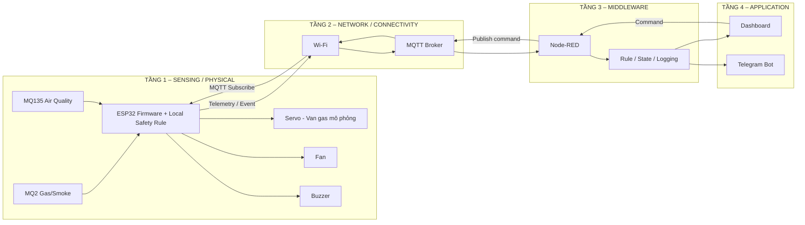

# 🛡️ TUẦN 1 — PHÂN TÍCH BÀI TOÁN & KIẾN TRÚC HỆ THỐNG IoT

> [← README](../README.md) · [📚 Danh sách báo cáo hằng tuần](../README.md#bao-cao-hang-tuan)

## Mục lục

- [1. Problem Statement – Phân tích bài toán](#section-1)
- [2. Actors và Use Cases](#section-2)
- [3. Yêu cầu hệ thống](#section-3)
- [4. Input – Processing – Output](#section-4)
- [5. Logic tự động V1](#section-5)
- [6. Kiến trúc IoT 4 tầng – Version 1](#section-6)
- [7. MQTT Topic Map – Draft V1](#section-7)
- [8. BOM dự kiến](#section-8)
- [9. Test Scenarios được định nghĩa từ Tuần 1](#section-9)
- [10. Phân công nhóm N19](#section-10)
- [11. Definition of Done – Tuần 1](#section-11)
- [12. Đối sánh với rubric 100 điểm](#section-12)
- [13. Quyết định cần giữ cố định khi sang Tuần 2](#section-13)
- [14. Đầu vào sẵn sàng cho Tuần 2 – Simulation Tầng 1](#section-14)

---

## 0. Thông tin đề tài

| Thuộc tính | Nội dung |
|---|---|
| Nhóm | N19 |
| Mã đề tài | 6 |
| Tên đề tài | **Cảnh báo rò rỉ Gas & chất lượng không khí** |
| Nhóm ứng dụng | Safety |
| Thành viên | Trình Quốc An – Nguyễn Kim Long – Nguyễn Long Vỹ |
| Thời lượng | 10 tuần × 6 giờ/tuần/SV, tối thiểu 60 giờ/SV |
| Mục tiêu Tuần 1 | Phân tích bài toán, chốt phạm vi, xác định input/output và logic tự động, thiết kế kiến trúc IoT 4 tầng V1, BOM dự kiến và phân công nhóm |

> **Lưu ý an toàn:** Đây là hệ thống prototype/mô phỏng phục vụ học tập. MQ2/MQ135, servo và mạch tự lắp **không phải hệ thống an toàn khí gas được chứng nhận** và không nên dùng để bảo vệ người/tài sản trên đường gas thật. Nếu làm hardware bonus, servo chỉ nên mô phỏng cơ cấu van, không gắn trực tiếp vào hệ thống gas đang sử dụng.

---

<a id="section-1"></a>
# 1. Problem Statement – Phân tích bài toán

## 1.1. Bối cảnh

Trong không gian kín như bếp, phòng trọ, phòng kỹ thuật hoặc khu vực có thiết bị sử dụng gas, rò rỉ khí gas/khói có thể gây cháy nổ hoặc ảnh hưởng sức khỏe. Bên cạnh đó, chất lượng không khí kém cũng cần được phát hiện để kích hoạt thông gió và cảnh báo người dùng.

Việc chỉ hiển thị giá trị cảm biến là chưa đủ. Hệ thống cần có khả năng **tự phản ứng tại thiết bị ngay khi phát hiện nguy hiểm**, đồng thời truyền dữ liệu qua mạng để middleware xử lý, lưu log và gửi cảnh báo đến người dùng.

## 1.2. Vấn đề cần giải quyết

Hệ thống cần trả lời được 5 câu hỏi chính:

1. Không khí hiện tại có dấu hiệu gas/khói hoặc chất lượng không khí xấu hay không?
2. Khi vượt ngưỡng, hệ thống có phản ứng tự động mà không cần người dùng thao tác không?
3. Nếu Internet/MQTT bị mất, thiết bị có vẫn thực hiện phản ứng an toàn cục bộ không?
4. Người dùng có nhận được trạng thái/cảnh báo từ xa không?
5. Hệ thống có chứng minh được đầy đủ luồng IoT 4 tầng và luồng dữ liệu hai chiều không?

## 1.3. Mục tiêu tổng quát

Xây dựng hệ thống IoT mô phỏng có khả năng:

- giám sát tín hiệu gas/khói bằng MQ2;
- giám sát chất lượng không khí bằng MQ135;
- xử lý dữ liệu trên ESP32;
- tự động đóng van gas mô phỏng, bật quạt và buzzer khi có nguy hiểm;
- truyền telemetry/event qua MQTT;
- dùng Node-RED làm middleware/automation engine;
- hiển thị trạng thái và gửi cảnh báo từ xa qua Telegram Bot hoặc dashboard;
- cho phép một số lệnh từ xa nhưng luôn bị ràng buộc bởi quy tắc an toàn tại ESP32.

## 1.4. Phạm vi thực hiện

### Trong phạm vi

- Simulation là thành phần bắt buộc.
- Mô phỏng sensor/input và actuator/output.
- ESP32 đọc dữ liệu, xử lý trạng thái và điều khiển actuator.
- Kết nối Wi-Fi và MQTT.
- MQTT Broker và Node-RED.
- Dashboard/trạng thái và Telegram cảnh báo.
- Automation rule, state machine, log sự kiện.
- Uplink: Device → MQTT → Middleware → Application.
- Downlink: Application/Middleware → MQTT → Device → Actuator.
- Test tình huống bình thường, cảnh báo, mất mạng và phục hồi.

### Ngoài phạm vi Tuần 1

- Wiring hoàn chỉnh trên simulator: thực hiện Tuần 2.
- Calibration và chốt threshold thực tế: thực hiện Tuần 3.
- MQTT connection chạy thật: Tuần 4.
- Node-RED flow hoàn chỉnh: Tuần 5.
- Application hoàn chỉnh: Tuần 6.
- Hardware vật lý: tùy chọn/bonus, chỉ nên làm sau khi simulation ổn định.

## 1.5. Giả định thiết kế

- MQ2 và MQ135 được xem là nguồn dữ liệu analog biểu diễn mức khí/chất lượng không khí.
- Trong simulation, nếu simulator không có đúng module MQ2/MQ135 thì có thể dùng input analog tương đương để tạo tín hiệu và giải thích rõ mapping.
- Ngưỡng trong giai đoạn mô phỏng là **ngưỡng thử nghiệm**, không phải ngưỡng chứng nhận an toàn thực tế.
- Phản ứng nguy hiểm phải được thực hiện **cục bộ trên ESP32 trước**, không phụ thuộc Node-RED hay Telegram.

---

<a id="section-2"></a>
# 2. Actors và Use Cases

## 2.1. Actors

| Actor | Vai trò |
|---|---|
| Người dùng | Theo dõi trạng thái, nhận cảnh báo, xác nhận/reset hệ thống khi điều kiện an toàn |
| MQ2 | Cung cấp tín hiệu liên quan gas/khói |
| MQ135 | Cung cấp tín hiệu đại diện chất lượng không khí |
| ESP32 | Đọc sensor, xử lý logic local, điều khiển actuator, giao tiếp MQTT |
| MQTT Broker | Trung gian truyền message giữa device, middleware và application |
| Node-RED | Xử lý rule, log, cảnh báo, dashboard và command |
| Telegram Bot / Dashboard | Giao diện/application cho người dùng |

## 2.2. Danh sách Use Case

| ID | Use Case | Actor chính | Kết quả mong đợi |
|---|---|---|---|
| UC01 | Theo dõi môi trường | ESP32, MQ2, MQ135 | Đọc dữ liệu định kỳ và xác định trạng thái |
| UC02 | Xử lý rò rỉ gas | ESP32 | Đóng van mô phỏng, bật quạt, bật buzzer |
| UC03 | Xử lý chất lượng không khí kém | ESP32 | Bật quạt thông gió và phát event cảnh báo |
| UC04 | Gửi telemetry | ESP32 | Publish dữ liệu lên MQTT |
| UC05 | Gửi cảnh báo khẩn | Node-RED | Gửi message Telegram khi trạng thái nguy hiểm |
| UC06 | Xem trạng thái từ xa | Người dùng | Xem sensor/state/actuator trên dashboard hoặc Telegram |
| UC07 | Gửi command từ xa | Người dùng | Command được Node-RED publish xuống ESP32 |
| UC08 | Khôi phục sau cảnh báo | Người dùng + ESP32 | Chỉ cho reset/reopen khi dữ liệu đã trở lại an toàn |
| UC09 | Xử lý mất mạng | ESP32 | Local automation vẫn chạy; MQTT tự reconnect khi mạng trở lại |

## 2.3. Use Case quan trọng – UC02: Phát hiện gas nguy hiểm

**Tiền điều kiện:** ESP32 đang hoạt động và MQ2 có dữ liệu hợp lệ.

**Luồng chính:**

1. ESP32 đọc giá trị MQ2.
2. Firmware lọc/chuẩn hóa dữ liệu.
3. Giá trị đạt mức `GAS_DANGER`.
4. ESP32 chuyển state sang `DANGER`.
5. ESP32 đóng servo van gas mô phỏng.
6. ESP32 bật quạt.
7. ESP32 bật buzzer.
8. ESP32 publish event lên MQTT nếu network khả dụng.
9. Node-RED nhận event, ghi log và gửi Telegram.
10. Application cập nhật trạng thái nguy hiểm.

**Luồng ngoại lệ:** Nếu mất Wi-Fi/MQTT, bước 5–7 vẫn phải thực hiện bình thường. Hệ thống chỉ thiếu cảnh báo từ xa và sẽ gửi trạng thái lại sau khi kết nối phục hồi.

## 2.4. Use Case quan trọng – UC08: Reset hệ thống

1. Người dùng yêu cầu reset từ application.
2. Node-RED publish command xuống MQTT.
3. ESP32 nhận command.
4. ESP32 kiểm tra sensor có nằm trong vùng an toàn ổn định hay không.
5. Nếu chưa an toàn → từ chối reset/reopen và giữ trạng thái `DANGER/RECOVERY`.
6. Nếu đã an toàn đủ thời gian → cho phép chuyển về `NORMAL`.

**Nguyên tắc:** Command từ xa không được phép vô hiệu hóa quy tắc safety khi sensor vẫn báo nguy hiểm.

---

<a id="section-3"></a>
# 3. Yêu cầu hệ thống

## 3.1. Functional Requirements

| ID | Yêu cầu chức năng | Ưu tiên |
|---|---|---|
| FR01 | Đọc MQ2 và MQ135 theo chu kỳ | Must |
| FR02 | Chuẩn hóa/lọc tín hiệu cảm biến | Must |
| FR03 | Xác định state dựa trên threshold | Must |
| FR04 | Tự động điều khiển servo, quạt, buzzer khi nguy hiểm | Must |
| FR05 | Publish telemetry qua MQTT | Must |
| FR06 | Publish event khi thay đổi trạng thái/có cảnh báo | Must |
| FR07 | Node-RED xử lý rule và ghi log | Must |
| FR08 | Gửi cảnh báo Telegram | Must |
| FR09 | Hiển thị trạng thái sensor + actuator | Must |
| FR10 | Nhận ít nhất một command từ xa | Must |
| FR11 | Local safety hoạt động khi network lỗi | Must |
| FR12 | MQTT tự reconnect và đồng bộ lại trạng thái | Should |
| FR13 | Cho phép cấu hình threshold qua middleware | Could |

## 3.2. Non-functional Requirements

| ID | Yêu cầu | Mục tiêu thiết kế |
|---|---|---|
| NFR01 | Safety-first | Local control có ưu tiên cao hơn remote command |
| NFR02 | Độ trễ phản ứng | Actuator local phản ứng gần như tức thời sau khi rule được xác nhận; không chờ cloud |
| NFR03 | Ổn định | Không kích hoạt liên tục do nhiễu; dùng filtering/hysteresis/debounce |
| NFR04 | Khả năng phục hồi | Tự reconnect Wi-Fi/MQTT |
| NFR05 | Quan sát được | Có telemetry, event log, state và actuator status |
| NFR06 | Tái lập demo | Các kịch bản test phải chạy lặp lại được |
| NFR07 | Bảo trì | Threshold/topic/config được tách khỏi logic chính |
| NFR08 | Bảo mật cơ bản | Không hard-code token/mật khẩu vào repo public; dùng file secrets/config khi triển khai |

---

<a id="section-4"></a>
# 4. Input – Processing – Output

## 4.1. Input

| Input | Loại | Ý nghĩa |
|---|---|---|
| MQ2 | Analog | Tín hiệu đại diện mức gas/khói |
| MQ135 | Analog | Tín hiệu đại diện chất lượng không khí |
| MQTT command | Digital/network | Lệnh từ middleware/application |
| Wi-Fi/MQTT status | System | Trạng thái kết nối |

## 4.2. Processing

ESP32 thực hiện pipeline:

`Read ADC → Filter → Normalize → Compare Threshold → Determine State → Safety Rule → Actuator → Publish Telemetry/Event`

Node-RED thực hiện:

`Subscribe MQTT → Validate Payload → Store/Log → Automation Rule → Dashboard/Telegram → Publish Command`

## 4.3. Output / Actuator

| Output | Trạng thái | Vai trò |
|---|---|---|
| Servo van gas | OPEN/CLOSED | Mô phỏng đóng nguồn gas khi nguy hiểm |
| Quạt | ON/OFF | Thông gió |
| Buzzer | ON/OFF | Cảnh báo tại chỗ |
| Telegram | Message | Cảnh báo từ xa |
| Dashboard | Values/State | Theo dõi dữ liệu và trạng thái |

---

<a id="section-5"></a>
# 5. Logic tự động V1

## 5.1. State Machine đề xuất

### NORMAL

- Gas: bình thường.
- Air quality: bình thường.
- Valve: OPEN.
- Fan: OFF.
- Buzzer: OFF.

### AIR_WARNING

- MQ135 vượt ngưỡng chất lượng không khí.
- Valve: OPEN.
- Fan: ON.
- Buzzer: OFF hoặc cảnh báo nhẹ tùy thiết kế cuối.
- Publish warning event.

### GAS_WARNING

- MQ2 tăng đến vùng cảnh báo nhưng chưa đạt mức nguy hiểm.
- Fan: ON.
- Publish warning event.
- Valve/Buzzer phụ thuộc rule sau calibration.

### DANGER

- MQ2 đạt ngưỡng nguy hiểm.
- Valve: CLOSED.
- Fan: ON.
- Buzzer: ON.
- Publish critical event.
- Gửi Telegram.
- Remote command không được phép mở valve trực tiếp.

### RECOVERY

- Sensor đã giảm nhưng chưa đủ điều kiện reset.
- Valve tiếp tục CLOSED.
- Fan tiếp tục ON trong thời gian làm sạch.
- Chỉ trở về NORMAL khi dữ liệu an toàn ổn định và có điều kiện reset phù hợp.

## 5.2. Priority Rule

Thứ tự ưu tiên:

`DANGER > GAS_WARNING > AIR_WARNING > NORMAL`

Nếu nhiều điều kiện xuất hiện đồng thời, trạng thái có mức nguy hiểm cao hơn quyết định actuator.

## 5.3. Pseudocode logic

```text
read gas_value
read air_value
filter values

if gas_value >= GAS_DANGER:
    state = DANGER
    valve = CLOSED
    fan = ON
    buzzer = ON

else if gas_value >= GAS_WARNING:
    state = GAS_WARNING
    fan = ON

else if air_value >= AQ_WARNING:
    state = AIR_WARNING
    fan = ON

else:
    state = NORMAL
    fan = OFF
    buzzer = OFF
    valve = OPEN only when safety-reset condition is satisfied

publish telemetry periodically
publish event when state changes
```

> Chưa chốt giá trị `GAS_WARNING`, `GAS_DANGER`, `AQ_WARNING` ở Tuần 1. Các giá trị này phải được định nghĩa/calibrate ở Tuần 3. Trong Tuần 2 có thể dùng giá trị ADC giả lập để kiểm tra logic.

---

<a id="section-6"></a>
# 6. Kiến trúc IoT 4 tầng – Version 1

## 6.1. Kiến trúc logic



## 6.2. Luồng Uplink bắt buộc

`MQ2/MQ135 → ESP32 → Wi-Fi → MQTT Broker → Node-RED → Dashboard/Telegram`

Ví dụ:

1. MQ2 tăng.
2. ESP32 phát hiện `DANGER` và đóng van/bật quạt/buzzer.
3. ESP32 publish `gascheck/n19/event`.
4. Node-RED nhận event.
5. Node-RED cập nhật dashboard và gửi Telegram.

## 6.3. Luồng Downlink bắt buộc

`Dashboard/Node-RED → MQTT Broker → ESP32 → Safety Validation → Actuator`

Ví dụ an toàn:

1. Người dùng nhấn `Reset Safe State`.
2. Node-RED publish command.
3. ESP32 nhận command.
4. ESP32 kiểm tra gas/air hiện tại.
5. Nếu còn nguy hiểm → reject command.
6. Nếu đã an toàn → thực hiện reset theo state machine.

## 6.4. Quyết định kiến trúc quan trọng

### Quyết định A – Safety logic nằm ở ESP32

Không đặt toàn bộ logic nguy hiểm trên Node-RED vì nếu Wi-Fi/MQTT lỗi thì thiết bị vẫn phải đóng van/bật quạt/buzzer.

### Quyết định B – Node-RED là middleware, không chỉ forward dữ liệu

Node-RED chịu trách nhiệm:

- validate payload;
- rule bổ sung;
- logging/event history;
- chống spam cảnh báo;
- Telegram integration;
- dashboard;
- publish command xuống device.

### Quyết định C – Application không trực tiếp điều khiển actuator

Command phải đi qua middleware + MQTT và được ESP32 kiểm tra safety condition trước khi tác động.

### Quyết định D – Simulation là baseline chính

Kiến trúc phải chạy được trên simulation trước. Hardware thật chỉ là bonus và không được thay thế simulation.

---

<a id="section-7"></a>
# 7. MQTT Topic Map – Draft V1

> Topic map chính thức sẽ hoàn thiện ở Tuần 4. Tuần 1 chỉ chốt naming convention để kiến trúc nhất quán.

| Topic | Direction | Nội dung |
|---|---|---|
| `gascheck/n19/telemetry` | ESP32 → Broker | Dữ liệu định kỳ MQ2/MQ135 + state |
| `gascheck/n19/event` | ESP32 → Broker | Event khi warning/danger/state change |
| `gascheck/n19/status` | ESP32 → Broker | Trạng thái device/actuator |
| `gascheck/n19/cmd` | Node-RED → ESP32 | Command từ xa |
| `gascheck/n19/config` | Node-RED → ESP32 | Threshold/config tùy chọn |

## 7.1. Payload telemetry mẫu

```json
{
  "device_id": "n19-gascheck-01",
  "gas_raw": 0,
  "air_raw": 0,
  "state": "NORMAL",
  "valve": "OPEN",
  "fan": "OFF",
  "buzzer": "OFF",
  "wifi": true,
  "uptime_ms": 0
}
```

## 7.2. Payload event mẫu

```json
{
  "type": "GAS_DANGER",
  "severity": "CRITICAL",
  "value": 0,
  "threshold": 0,
  "state": "DANGER"
}
```

## 7.3. Command mẫu

```json
{
  "action": "RESET_SAFE_STATE"
}
```

---

<a id="section-8"></a>
# 8. BOM dự kiến

## 8.1. BOM phần cứng / mô phỏng

| STT | Thành phần | SL | Mục đích | Bắt buộc |
|---:|---|---:|---|---|
| 1 | ESP32 DevKit | 1 | Controller + Wi-Fi/MQTT | Có |
| 2 | MQ2 gas/smoke sensor/module | 1 | Input gas/khói | Có về mặt chức năng |
| 3 | MQ135 air quality sensor/module | 1 | Input chất lượng không khí | Có về mặt chức năng |
| 4 | Servo SG90 hoặc actuator tương đương | 1 | Mô phỏng van gas | Có |
| 5 | Fan/DC motor hoặc output mô phỏng tương đương | 1 | Thông gió | Có |
| 6 | Buzzer | 1 | Cảnh báo local | Có |
| 7 | LED trạng thái | 2–3 | Debug/hiển thị state | Tùy chọn |
| 8 | Breadboard + jumper | 1 bộ | Hardware bonus | Tùy chọn |
| 9 | Driver transistor/MOSFET/relay + diode bảo vệ | 1 bộ | Điều khiển fan thật | Chỉ nếu làm hardware |
| 10 | Mạch chia áp phù hợp | Theo thiết kế | Bảo vệ ADC ESP32 khi module analog có điện áp cao hơn mức ADC cho phép | Chỉ nếu làm hardware |
| 11 | Nguồn phù hợp | 1 | Cấp nguồn | Chỉ nếu làm hardware |

> Nếu Wokwi/Tinkercad không có đúng MQ2/MQ135, nhóm có thể dùng potentiometer/input analog hoặc custom component để mô phỏng tín hiệu cảm biến, miễn demo được **input thay đổi → processing → actuator phản ứng** và tài liệu giải thích rõ sự thay thế.

## 8.2. BOM phần mềm/dịch vụ

| Thành phần | Vai trò |
|---|---|
| Wokwi / simulator tương đương | Simulation Tầng 1–2 |
| Arduino framework/ESP32 firmware | Embedded logic |
| MQTT Broker | Message transport |
| Node-RED | Middleware + automation + logging |
| Node-RED Dashboard hoặc dashboard tương đương | Visualization |
| Telegram Bot | Remote alert |
| GitHub | Quản lý source, docs, flow export |

---

<a id="section-9"></a>
# 9. Test Scenarios được định nghĩa từ Tuần 1

| ID | Scenario | Input | Expected Output |
|---|---|---|---|
| TC01 | Normal | MQ2 thấp, MQ135 bình thường | Valve OPEN, Fan OFF, Buzzer OFF, state NORMAL |
| TC02 | Air quality warning | MQ135 vượt AQ_WARNING | Fan ON, event warning, valve không bị đóng nếu MQ2 an toàn |
| TC03 | Gas danger | MQ2 vượt GAS_DANGER | Valve CLOSED, Fan ON, Buzzer ON, critical event |
| TC04 | Gas + poor air simultaneously | Cả hai vượt ngưỡng | State DANGER, ưu tiên gas safety |
| TC05 | MQTT disconnected | Gas vượt ngưỡng khi mất MQTT | Local actuator vẫn phản ứng đúng |
| TC06 | MQTT reconnect | Network quay lại | Device reconnect và publish status mới |
| TC07 | Unsafe remote reset | User reset khi gas vẫn cao | ESP32 reject reset/open valve |
| TC08 | Recovery | Sensor trở về safe ổn định | Chuyển RECOVERY → NORMAL theo điều kiện đã thiết kế |

---

<a id="section-10"></a>
# 10. Phân công nhóm N19

Theo cấu trúc nhóm 3 SV trong rubric, phân công primary như sau:

| Thành viên | Vai trò chính | Tuần 1–6 | Cross-review bắt buộc |
|---|---|---|---|
| **Trình Quốc An** | Sensing / Embedded | Simulation, circuit, MQ2/MQ135, actuator, firmware/state machine | Hiểu MQTT, Node-RED, application và luồng E2E |
| **Nguyễn Kim Long** | Network / Middleware | Wi-Fi, MQTT topic/payload, broker, Node-RED, logging/rule | Hiểu sensor/actuator, firmware và application |
| **Nguyễn Long Vỹ** | Application / Automation | Dashboard, Telegram, command, business rules | Hiểu firmware, MQTT, Node-RED và luồng E2E |

## 10.1. Công việc Tuần 1 – 6 giờ/SV

### Trình Quốc An

- 2h: phân tích MQ2/MQ135 và actuator cần dùng.
- 2h: draft input-processing-output + state machine.
- 1h: review BOM và khả năng simulation.
- 1h: cross-review kiến trúc 4 tầng.

**Evidence:** ghi chú sensor/actuator, state diagram, BOM review.

### Nguyễn Kim Long

- 2h: phân tích kiến trúc 4 tầng và luồng uplink/downlink.
- 2h: draft MQTT topic/payload và middleware responsibilities.
- 1h: viết functional/non-functional requirements.
- 1h: cross-review use case + state machine.

**Evidence:** architecture V1, MQTT draft, requirements.

### Nguyễn Long Vỹ

- 2h: phân tích use case người dùng, dashboard và Telegram.
- 2h: thiết kế luồng alert/remote command/reset.
- 1h: định nghĩa test scenarios.
- 1h: cross-review architecture + MQTT.

**Evidence:** use case, application flow, test scenarios.

## 10.2. Nguyên tắc nghiệm thu cá nhân

Mỗi thành viên phải tự giải thích được:

1. Sensor nào tạo dữ liệu và actuator nào phản ứng.
2. ESP32 xử lý safety rule ở đâu.
3. MQTT dùng để làm gì.
4. Node-RED xử lý gì ngoài việc forward data.
5. Application nhận dữ liệu/gửi command như thế nào.
6. Uplink và downlink đi qua các tầng nào.
7. Điều gì xảy ra khi mất mạng.

---

<a id="section-11"></a>
# 11. Definition of Done – Tuần 1

Tuần 1 được xem là hoàn thành khi nhóm đạt đủ các điều kiện sau:

- [x] Xác định rõ Problem Statement.
- [x] Chốt mục tiêu và scope.
- [x] Xác định actors và các use case chính.
- [x] Xác định sensor/input: MQ2, MQ135.
- [x] Xác định actuator/output: servo valve, fan, buzzer.
- [x] Chốt nguyên tắc local safety trên ESP32.
- [x] Có state machine V1.
- [x] Có kiến trúc 4 tầng V1.
- [x] Có ít nhất một luồng uplink V1.
- [x] Có ít nhất một luồng downlink V1.
- [x] Có MQTT topic map draft.
- [x] Có BOM dự kiến.
- [x] Có test scenarios ban đầu.
- [x] Có bảng phân công 3 thành viên.
- [x] Mỗi thành viên có nhiệm vụ cross-review để hiểu toàn bộ hệ thống.

---

<a id="section-12"></a>
# 12. Đối sánh với rubric 100 điểm

Tuần 1 **không đồng nghĩa đã đạt các điểm bên dưới**, vì rubric chấm trên hệ thống chạy thật/simulation và evidence cuối kỳ. Tuy nhiên thiết kế Tuần 1 đã tạo nền tảng trực tiếp cho các hạng mục:

| Rubric | Điểm | Nội dung Tuần 1 hỗ trợ |
|---|---:|---|
| Simulation & Embedded | 20 | Chốt sensor, actuator, local logic và BOM để triển khai W2–W3 |
| Kiến trúc 4 tầng IoT | 25 | Hoàn thành architecture V1 + uplink/downlink |
| Automation / Control Logic | 20 | State machine, priority rule, safety reset, network-failure behavior |
| Application / Integration | 15 | Chốt dashboard/Telegram + remote command flow |
| Demo & độ ổn định | 10 | Định nghĩa test scenarios và abnormal scenarios từ đầu |
| Báo cáo & deliverables | 10 | Có Problem Statement, Use Case, architecture, BOM, assignment và tài liệu nền |

**Điểm tiến độ của Tuần 1 theo kế hoạch: 5%.**

---

<a id="section-13"></a>
# 13. Quyết định cần giữ cố định khi sang Tuần 2

1. **ESP32 là controller chính.**
2. **MQ2 + MQ135 là hai input logic của bài toán.**
3. **Servo + fan + buzzer là ba output chính.**
4. **Local safety rule nằm trên ESP32.**
5. **MQTT là giao thức truyền dữ liệu chính.**
6. **Node-RED là middleware/automation engine.**
7. **Telegram + dashboard là lớp application.**
8. **Simulation là bắt buộc; hardware là bonus.**
9. **Không chốt ngưỡng an toàn thực tế trong Tuần 1.**
10. **Remote command không được override trạng thái nguy hiểm.**

---

<a id="section-14"></a>
# 14. Đầu vào sẵn sàng cho Tuần 2 – Simulation Tầng 1

Sau tài liệu Tuần 1, Tuần 2 có thể bắt đầu ngay với các công việc:

1. Tạo project Wokwi/Simulator cho ESP32.
2. Mapping MQ2/MQ135 hoặc input analog mô phỏng.
3. Nối servo, buzzer và output mô phỏng quạt.
4. Viết firmware tối thiểu đọc input.
5. Test sensor/input thay đổi.
6. Test actuator phản ứng theo state.
7. Chụp sơ đồ circuit/wiring và lưu link simulation V1.

**Milestone kế tiếp:** W2 phải có simulation hoạt động; nếu chưa có simulation thì chưa đạt Device Prototype theo kế hoạch môn học.
