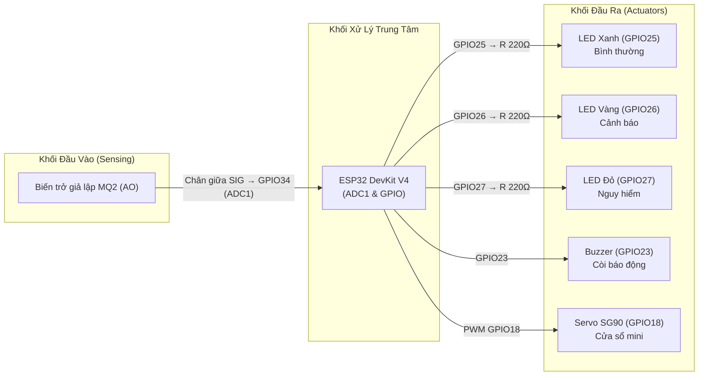

# 🛡️ BÁO CÁO TIẾN ĐỘ TUẦN 2 — SIMULATION TẦNG 1 (SENSING / PHYSICAL)

> **Dự án:** IOT-Safety-GasCheck · Nhóm N19 · Đề tài 06 (Lĩnh vực: Safety)  
> **Thời gian:** Tuần 2 (Thời lượng: 6 giờ / SV × 3 SV = 18 giờ)  
> **Milestone nghiệm thu:** **M1 – Device Prototype (Simulation BẮT BUỘC)**  
> **Tỷ trọng tiến độ:** 10%

---

## 1. Mục tiêu kỹ thuật Tuần 2

1. **Dựng mạch mô phỏng trên Wokwi (2h):**
   - Thiết lập bo mạch ESP32 DevKit V4.
   - Kết nối biến trở (Potentiometer) giả lập cảm biến khí gas MQ2 qua cổng ADC1 (GPIO34).
   - Kết nối 3 LED trạng thái (Xanh - GPIO25, Vàng - GPIO26, Đỏ - GPIO27) kèm điện trở hạn dòng 220Ω.
   - Kết nối còi báo động (Buzzer - GPIO23) và động cơ Servo mini SG90 (GPIO18) mô phỏng cơ cấu mở cửa sổ thông thoáng.
2. **Đọc và chuyển đổi tín hiệu Sensor/Input (2h):**
   - Lập trình đọc điện áp analog từ ADC 12-bit (0 – 4095).
   - Kiểm tra dải điện áp an toàn 0 – 3.3V, đảm bảo không vượt quá giới hạn của chân ADC ESP32.
3. **Điều khiển Actuator/Output và kiểm tra Wiring (2h):**
   - Lập trình điều khiển bật/tắt 3 LED theo ngưỡng nồng độ gas.
   - Lập trình còi buzzer kêu ngắt quãng ở mức cảnh báo và kêu liên tục ở mức nguy cấp.
   - Điều khiển xung PWM cho Servo SG90: đóng cửa ở 0° và mở cửa ở 90°.
   - Kiểm thử tính độc lập của cảnh báo cục bộ: hoạt động tức thì ngay tại mạch mà không phụ thuộc vào kết nối mạng.

---

## 2. Sơ đồ mạch và Bảng đấu dây (Circuit / Wiring)

### 2.1. Sơ đồ khối kết nối mạch (Mermaid)

### 2.2. Bảng đấu dây chi tiết (Wiring Map)

| Thiết bị linh kiện | Chân linh kiện | Chân trên ESP32 | Điện áp / Ghi chú |
|---|---|---|---|
| **Biến trở (MQ2)** | VCC | 3V3 | Cấp nguồn 3.3V chuẩn ADC |
| | GND | GND.1 | Nối mass chung |
| | SIG (Chân giữa) | GPIO34 | ADC1 Channel 6 (Chân chỉ đọc input) |
| **LED Xanh (Normal)** | Anode (+) | GPIO25 | Qua điện trở hạn dòng 220Ω |
| | Cathode (-) | GND.1 | Nối mass chung |
| **LED Vàng (Warning)**| Anode (+) | GPIO26 | Qua điện trở hạn dòng 220Ω |
| | Cathode (-) | GND.1 | Nối mass chung |
| **LED Đỏ (Danger)** | Anode (+) | GPIO27 | Qua điện trở hạn dòng 220Ω |
| | Cathode (-) | GND.1 | Nối mass chung |
| **Buzzer** | Chân (+) | GPIO23 | Tín hiệu điều khiển âm thanh |
| | Chân (-) | GND.2 | Nối mass chung |
| **Servo SG90** | Dây cam (PWM) | GPIO18 | Tín hiệu xung điều khiển góc quay |
| | Dây đỏ (V+) | 5V (VIN) | Cấp nguồn 5V dòng tải riêng |
| | Dây nâu (GND) | GND.2 | Nối mass chung với ESP32 |

> [!NOTE]
> File cấu hình đồ họa mạch mô phỏng đầy đủ đã được lưu trữ tại [simulation/diagram.json](../simulation/diagram.json). Người dùng chỉ cần copy và paste vào Wokwi là mạch lập tức hiển thị trực quan và sẵn sàng vận hành.

---

## 3. Mã nguồn Prototype Tuần 2

Mã nguồn kiểm thử phần cứng mức cơ sở được lưu tại [simulation/sketch_w2.ino](../simulation/sketch_w2.ino). Điểm nổi bật trong firmware Tuần 2:
- Sử dụng thư viện `ESP32Servo` cấp timer PWM riêng biệt (Timer 0) ở tần số 50Hz, tránh xung đột tài nguyên hệ thống.
- Cấu hình các ngưỡng logic phân định 3 trạng thái:
  - `NORMAL`: ADC < 1500 → LED Xanh sáng, Buzzer tắt, Servo 0° (Cửa đóng).
  - `WARNING`: 1500 ≤ ADC < 2500 → LED Vàng sáng, Buzzer ngắt quãng, Servo 0° (Cửa đóng).
  - `DANGER`: ADC ≥ 2500 → LED Đỏ sáng, Buzzer kêu liên tục, Servo 90° (Cửa mở thông thoáng).
- Toàn bộ trạng thái được xuất log qua Serial Monitor với tốc độ baud 115200.

---

## 4. Kết quả kiểm thử trên Wokwi (Test Matrix)

| Test ID | Tín hiệu mô phỏng (ADC) | Phản ứng LED | Phản ứng Buzzer | Góc Servo | Đánh giá |
|:---:|---|:---:|:---:|:---:|:---:|
| **TC01** | ADC = 680 (Dưới ngưỡng Warning) | LED Xanh ON, Vàng/Đỏ OFF | OFF | 0° (Đóng) | **PASS** |
| **TC02** | ADC = 1450 (Cận dưới Warning) | LED Xanh ON | OFF | 0° (Đóng) | **PASS** |
| **TC03** | ADC = 1850 (Mức Warning) | LED Vàng ON, Xanh/Đỏ OFF | Kêu ngắt quãng (Beep) | 0° (Đóng) | **PASS** |
| **TC04** | ADC = 2450 (Cận dưới Danger) | LED Vàng ON | Kêu ngắt quãng | 0° (Đóng) | **PASS** |
| **TC05** | ADC = 2850 (Mức Danger) | LED Đỏ ON, Xanh/Vàng OFF | Kêu liên tục | 90° (Mở) | **PASS** |
| **TC06** | ADC = 4095 (Mức cực đại Danger) | LED Đỏ ON | Kêu liên tục | 90° (Mở) | **PASS** |
| **TC07** | Không có mạng Wi-Fi/Internet | Mạch cảnh báo tức thì | Kêu đúng mức | Đóng/Mở đúng | **PASS** |

---

## 5. Kết luận nghiệm thu Milestone M1

- **Kết quả nghiệm thu:** **ĐẠT (PASS)** điều kiện tiên quyết Milestone M1.
- Dự án đã hoàn thiện 100% phần mô phỏng Tầng 1 (Sensing/Physical) trên Wokwi.
- Minh chứng nộp kèm:
  - File sơ đồ Wokwi: [simulation/diagram.json](../simulation/diagram.json)
  - Mã nguồn thực thi: [simulation/sketch_w2.ino](../simulation/sketch_w2.ino)
  - Hướng dẫn vận hành: [simulation/README.md](../simulation/README.md)
- Kế hoạch tiếp theo cho Tuần 3: Tối ưu hóa thuật toán lọc nhiễu trung bình động (Moving Average Filter), cài đặt State Machine đầy đủ 5 trạng thái kèm cơ chế Hysteresis chống rung và Safety Interlock.
