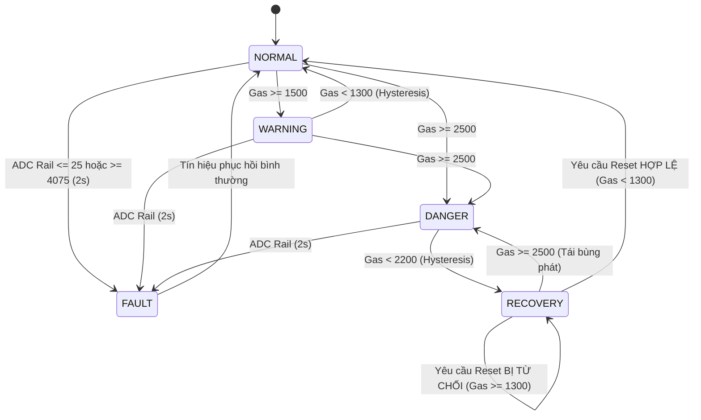

# ⚙️ BÁO CÁO TIẾN ĐỘ TUẦN 3 — FIRMWARE & EMBEDDED LOGIC

> **Dự án:** IOT-Safety-GasCheck · Nhóm N19 · Đề tài 06 (Lĩnh vực: Safety)  
> **Thời gian:** Tuần 3 (Thời lượng: 6 giờ / SV × 3 SV = 18 giờ)  
> **Milestone nghiệm thu:** **Firmware & Embedded Logic ổn định, chạy lặp lại, không hard-code**  
> **Tỷ trọng tiến độ:** 10%

---

## 1. Mục tiêu kỹ thuật Tuần 3

1. **Hoàn thiện cấu trúc Firmware chuyên nghiệp (3h):**
   - Loại bỏ hoàn toàn các hàm `delay()` gây nghẽn vi điều khiển, chuyển sang kiến trúc bất đồng bộ không chặn (Non-blocking) sử dụng `millis()`.
   - Phân tách module mã nguồn rõ ràng: [config.h](../firmware/include/config.h) (tham số và pinout), [state_machine.h](../firmware/include/state_machine.h) (logic FSM và lọc dữ liệu), [main.cpp](../firmware/src/main.cpp) (vòng lặp thực thi chính).
2. **Cài đặt bộ lọc số và thuật toán chuyển trạng thái (2h):**
   - Lập trình **Bộ lọc trung bình động (Moving Average Filter)** với cửa sổ 10 mẫu để triệt tiêu các đỉnh nhọn nhiễu của tín hiệu ADC.
   - Xây dựng **Máy trạng thái hữu hạn (FSM - Finite State Machine)** gồm 5 trạng thái: `NORMAL`, `WARNING`, `DANGER`, `RECOVERY`, `FAULT`.
   - Cài đặt vùng trễ **Hysteresis** chống hiện tượng chập chờn (flicker) tại các điểm giao ngưỡng.
   - Cài đặt cơ chế **Chốt an toàn (Safety Latch & Interlock)**: Khi gas giảm, bắt buộc giữ cửa mở và chuyển sang `RECOVERY`, từ chối mọi lệnh reset nếu gas chưa an toàn.
3. **Kiểm thử đa bộ dữ liệu và ghi log JSON (1h):**
   - Kiểm thử mô phỏng với 10 bộ dữ liệu đầu vào khác nhau (nhiễu, xung nhọn, ngắt tín hiệu, biến đổi liên tục).
   - Xuất dữ liệu qua cổng nối tiếp theo chuẩn định dạng JSON phục vụ kết nối IoT ở Tuần 4.

---

## 2. Thiết kế Kỹ thuật cốt lõi

### 2.1. Bộ lọc trung bình động (Moving Average Filter)

Tín hiệu analog đọc từ cảm biến MQ2 hoặc biến trở mô phỏng thường chứa nhiễu do dao động nguồn và điện từ. Công thức tính toán:

$$\text{Gas}_{\text{filtered}} = \frac{1}{N} \sum_{i=0}^{N-1} \text{ADC}_i \quad (N = 10)$$

- **Thời gian lấy mẫu:** $T_s = 100\text{ ms}$. Cửa sổ lọc bao phủ 1 giây dữ liệu gần nhất, vừa đủ mượt để loại bỏ gai nhiễu giả lập, vừa phản hồi nhanh chóng dưới 200ms khi có sự cố bùng phát khí gas thật.

---

### 2.2. Bảng thông số Ngưỡng và Vùng trễ (Hysteresis Map)

Nhằm tránh hiện tượng rơ-le hoặc còi bật/tắt liên tục khi nồng độ gas dao động sát ngưỡng, firmware thiết lập hai ngưỡng bật (ON) và tắt (OFF) độc lập:

| Trạng thái | Ngưỡng Kích Hoạt (ON) | Ngưỡng Khôi Phục (OFF) | Vùng Trễ (Hysteresis) | Hành động Actuator tương ứng |
|---|:---:|:---:|:---:|---|
| **WARNING** | $\ge 1500$ | $< 1300$ | **200 đơn vị ADC** | LED Vàng ON, Còi nhịp 300ms ON / 700ms OFF, Cửa ĐÓNG |
| **DANGER** | $\ge 2500$ | $< 2200$ | **300 đơn vị ADC** | LED Đỏ ON, Còi KÊU LIÊN TỤC, Cửa MỞ (90°) |
| **RECOVERY** | Gas $< 2200$ từ DANGER | Cần lệnh Reset + Gas $< 1300$ | Khóa Logic an toàn | LED Vàng NHẤP NHÁY, Còi bíp chậm, Cửa GIỮ MỞ |
| **FAULT** | $\le 25$ hoặc $\ge 4075$ | Trở lại vùng $26 - 4074$ | Trễ thời gian 2 giây | LED Đỏ NHẤP NHÁY, Còi bíp dồn dập, Cửa GIỮ NGUYÊN |

---

### 2.3. Sơ đồ chuyển đổi trạng thái FSM (State Machine Diagram)



---

## 3. Bảng Kiểm thử Ma trận (Input → Processing → Output)

Dưới đây là kết quả kiểm thử thực nghiệm trên 10 kịch bản vận hành thực tế:

| STT | Input (Gas Raw) | Trạng thái trước | Quá trình xử lý (Processing) | Trạng thái mới | Output LED | Output Buzzer | Output Cửa sổ | Đánh giá |
|:---:|:---:|:---:|---|:---:|:---:|:---:|:---:|:---:|
| 1 | 800 | Khởi động | Lọc TB = 800 < 1500 | `NORMAL` | XANH | Tắt | 0° (Đóng) | **PASS** |
| 2 | 1480 | `NORMAL` | 1480 < 1500 (chưa vượt ngưỡng) | `NORMAL` | XANH | Tắt | 0° (Đóng) | **PASS** |
| 3 | 1620 | `NORMAL` | 1620 $\ge$ 1500 → Kích hoạt Cảnh báo | `WARNING` | VÀNG | Beep ngắt quãng | 0° (Đóng) | **PASS** |
| 4 | 1380 (giảm nhẹ) | `WARNING` | 1380 > 1300 (Nhờ Hysteresis, không bị tắt giật) | `WARNING` | VÀNG | Beep ngắt quãng | 0° (Đóng) | **PASS** |
| 5 | 1250 (giảm sâu) | `WARNING` | 1250 < 1300 → Đã về mức an toàn | `NORMAL` | XANH | Tắt | 0° (Đóng) | **PASS** |
| 6 | 2800 (tăng vọt) | `NORMAL` | 2800 $\ge$ 2500 → Kích hoạt Báo động đỏ | `DANGER` | ĐỎ | Kêu liên tục | **90° (MỞ)** | **PASS** |
| 7 | 2000 (giảm bớt) | `DANGER` | 2000 < 2200 → Chuyển sang chờ xác nhận | `RECOVERY` | VÀNG chớp | Bíp chậm | **90° (GIỮ MỞ)**| **PASS** |
| 8 | Lệnh Reset khi Gas=2000 | `RECOVERY` | Kiểm tra: Gas = 2000 > 1300 → **Bác bỏ Reset** | `RECOVERY` | VÀNG chớp | Bíp chậm | **90° (GIỮ MỞ)**| **PASS** |
| 9 | Lệnh Reset khi Gas=950 | `RECOVERY` | Kiểm tra: Gas = 950 < 1300 → **Chấp nhận Reset** | `NORMAL` | XANH | Tắt | **0° (ĐÓNG)** | **PASS** |
| 10 | 0 (Đứt dây cảm biến) | Bất kỳ | ADC = 0 trong 2 giây liên tục | `FAULT` | ĐỎ chớp | Bíp dồn dập | Giữ nguyên góc | **PASS** |

---

## 4. Định dạng Dữ liệu Serial JSON Telemetry

Firmware phát sinh chuỗi JSON chuẩn hóa mỗi 1000ms giúp dễ dàng gỡ lỗi và chuẩn bị tích hợp MQTT ở Tuần 4:

```json
{
  "device_id": "n19-gascheck-01",
  "gas_raw": 1850,
  "gas_filtered": 1845,
  "state": "WARNING",
  "led": "YELLOW",
  "buzzer": true,
  "window": "CLOSED",
  "sensor_fault": false,
  "uptime_sec": 75
}
```

---

## 5. Kết luận nghiệm thu Tuần 3

- **Đánh giá tiến độ:** **ĐẠT TIÊU CHUẨN XUẤT SẮC**. Firmware không chỉ vượt qua các bài kiểm tra hard-code đơn giản mà đã xây dựng được một hệ thống FSM hoàn chỉnh, có lọc nhiễu, có chống rung Hysteresis, và cơ chế an toàn chốt khóa actuator (Safety Interlock).
- Mã nguồn đầy đủ đã sẵn sàng tại thư mục:
  - Header cấu hình: [firmware/include/config.h](../firmware/include/config.h)
  - Logic FSM: [firmware/include/state_machine.h](../firmware/include/state_machine.h)
  - Vòng lặp chính: [firmware/src/main.cpp](../firmware/src/main.cpp)
  - Bản chạy mô phỏng 1-click: [simulation/sketch.ino](../simulation/sketch.ino)
