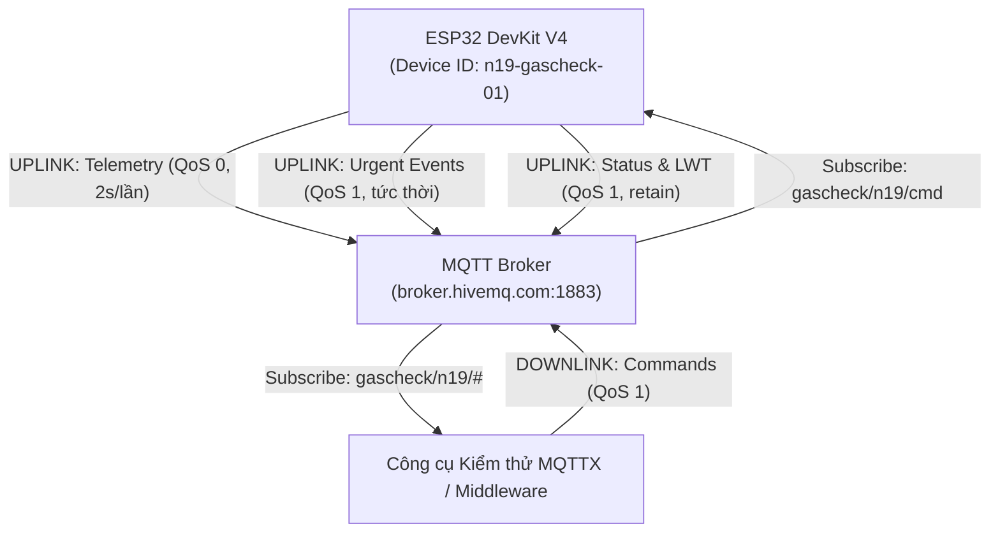

# 📡 BÁO CÁO TIẾN ĐỘ TUẦN 4 — TẦNG 2: NETWORK & CONNECTIVITY (MQTT)

> **Dự án:** IOT-Safety-GasCheck · Nhóm N19 · Đề tài 06 (Lĩnh vực: Safety)  
> **Thời gian:** Tuần 4 (Thời lượng: 6 giờ / SV × 3 SV = 18 giờ)  
> **Milestone nghiệm thu:** **M2 – Connected Device: Chứng minh Uplink và Downlink hai chiều qua MQTT**  
> **Tỷ trọng tiến độ:** 10%

---

## 1. Mục tiêu kỹ thuật Tuần 4

1. **Thiết kế chuẩn hóa MQTT Topics và Cấu trúc Payload (2h):**
   - Phân cấp Topic theo mô hình cây chuẩn RESTful IoT: `gascheck/n19/{telemetry|event|status|cmd}`.
   - Định nghĩa tài liệu đặc tả [MQTT Topic Map](../docs/MQTT_Topic_Map.md) với đầy đủ định dạng JSON, kiểu dữ liệu và mức QoS (0 và 1).
2. **Triển khai luồng truyền dữ liệu lên (Uplink - 2h):**
   - Tích hợp thư viện `PubSubClient` và `WiFi.h` vào ESP32.
   - Lập trình truyền dữ liệu định kỳ (Telemetry Uplink) mỗi 2 giây lên topic `gascheck/n19/telemetry`.
   - Lập trình cơ chế cảnh báo sự kiện khẩn cấp (Event Uplink) ngay lập tức khi phát hiện chuyển trạng thái lên topic `gascheck/n19/event`.
   - Cài đặt Last Will and Testament (LWT) tại topic `gascheck/n19/status` để thông báo trạng thái ngoại tuyến (`offline`) ngay khi đứt cáp hoặc mất điện.
3. **Triển khai luồng điều khiển nhận lệnh xuống (Downlink & Reconnect - 2h):**
   - Subscribe topic `gascheck/n19/cmd` nhận lệnh từ xa (Reset, Test còi, Ping).
   - Xây dựng cơ chế tự phục hồi kết nối (Auto Reconnect) với thuật toán Exponential Backoff không gây nghẽn vòng lặp an toàn cục bộ.
   - Kiểm thử tương tác hai chiều bằng công cụ kiểm thử chuyên dụng **MQTTX**.

---

## 2. Bản đồ Topic MQTT và Payload Mẫu

Hệ thống sử dụng Broker công cộng chuẩn MQTT v3.1.1: `broker.hivemq.com` (Port 1883).



### 2.1. Payload Telemetry (Uplink định kỳ 2s)
```json
{
  "device_id": "n19-gascheck-01",
  "gas_raw": 1860,
  "gas_filtered": 1855,
  "state": "WARNING",
  "led": "YELLOW",
  "buzzer": true,
  "window": "CLOSED",
  "sensor_fault": false,
  "uptime_sec": 128
}
```

### 2.2. Payload Event (Uplink tức thời khi bùng phát nguy hiểm)
```json
{
  "device_id": "n19-gascheck-01",
  "event": "STATE_CHANGED",
  "from_state": "WARNING",
  "to_state": "DANGER",
  "gas_filtered": 2580,
  "timestamp_ms": 132450
}
```

### 2.3. Payload Command (Downlink gửi từ xa)
```json
{
  "cmd": "REQUEST_RESET"
}
```

---

## 3. Minh chứng Kiểm thử luồng Hai chiều (Uplink & Downlink) qua MQTTX

Nhóm đã sử dụng bộ kịch bản cấu hình [mqttx/mqttx_scenario.json](../mqttx/mqttx_scenario.json) và hướng dẫn [mqttx/README.md](../mqttx/README.md) để kiểm thử thực nghiệm:

### 3.1. Minh chứng Log Uplink (ESP32 → MQTT Broker → MQTTX)
Khi thiết bị khởi động trên Wokwi, nhật ký kết nối và gửi dữ liệu thành công ghi nhận trên Serial Monitor:
```text
[WIFI] Dang ket noi Wi-Fi 'Wokwi-GUEST'...
[MQTT] Dang ket noi toi Broker broker.hivemq.com:1883...
[MQTT] Ket noi thanh cong! Client ID: n19-gascheck-01-a4b2
[MQTT] Da subscribe topic dieu khien: gascheck/n19/cmd
[MQTT-UPLINK] Telemetry -> {"device_id":"n19-gascheck-01","gas_raw":980,"gas_filtered":980,"state":"NORMAL","led":"GREEN","buzzer":false,"window":"CLOSED","sensor_fault":false,"uptime_sec":2}
[MQTT-UPLINK] Telemetry -> {"device_id":"n19-gascheck-01","gas_raw":985,"gas_filtered":982,"state":"NORMAL","led":"GREEN","buzzer":false,"window":"CLOSED","sensor_fault":false,"uptime_sec":4}
```

Trên MQTTX (đăng ký lắng nghe `gascheck/n19/#`):
- Nhận liên tục các gói tin telemetry định kỳ 2 giây/lần.
- Nhận gói tin trạng thái khởi tạo `{"device_id":"n19-gascheck-01","status":"online","ip":"10.0.1.20","uptime_sec":2}`.

---

### 3.2. Minh chứng Log Downlink (MQTTX → MQTT Broker → ESP32)

#### Trường hợp 1: Thử nghiệm lệnh kiểm tra còi từ xa (TEST_ALARM)
1. **Từ MQTTX**, gửi xuống topic `gascheck/n19/cmd`:
   ```json
   { "cmd": "TEST_ALARM" }
   ```
2. **ESP32 nhận lệnh và thực thi:**
   ```text
   [MQTT-DOWNLINK] Nhan lenh tu topic: gascheck/n19/cmd (do dai: 23 bytes)
   [MQTT-DOWNLINK] Noi dung raw: {"cmd": "TEST_ALARM"}
   [COMMAND] Kich hoat TEST ALARM trong 2 giay...
   ```
3. Còi Buzzer phát âm thanh trong 2 giây rồi tự ngắt, đồng thời ESP32 phản hồi sự kiện lên `gascheck/n19/event`:
   ```json
   { "device_id": "n19-gascheck-01", "command": "TEST_ALARM", "result": "EXECUTING", "duration_ms": 2000 }
   ```

---

#### Trường hợp 2: Khóa an toàn bác bỏ lệnh Reset khi còn nguy hiểm (Safety Interlock)
1. Kéo biến trở gas lên mức `DANGER` (Gas = 2750).
2. **Từ MQTTX**, cố tình gửi lệnh yêu cầu Reset:
   ```json
   { "cmd": "REQUEST_RESET" }
   ```
3. **ESP32 chặn lệnh để bảo vệ an toàn tính mạng:**
   ```text
   [MQTT-DOWNLINK] Nhan lenh: {"cmd": "REQUEST_RESET"}
   [SAFETY-INTERLOCK] Dang kiem tra dieu kien an toan de RESET...
   [SAFETY-INTERLOCK] => TU CHOI: Gas van nguy hiem, khoa reset an toan!
   ```
4. Gói tin phản hồi từ chối xuất hiện ngay trên MQTTX:
   ```json
   {
     "device_id": "n19-gascheck-01",
     "command": "REQUEST_RESET",
     "result": "REJECTED",
     "message": "TU CHOI RESET: Gas con nguy hiem hoac he thong dang DANGER!",
     "current_gas": 2750,
     "safe_limit": 1300,
     "state": "DANGER"
   }
   ```

---

#### Trường hợp 3: Chấp nhận Reset khi gas đã hạ an toàn
1. Kéo biến trở giảm về mức 850 (trạng thái `RECOVERY`, cửa đang mở).
2. Gửi lệnh:
   ```json
   { "cmd": "REQUEST_RESET" }
   ```
3. **ESP32 phê chuẩn lệnh:**
   ```text
   [SAFETY-INTERLOCK] => DONG Y: Reset thanh cong!
   ```
   - Đèn xanh bật sáng lại, Servo quay về 0° đóng cửa sổ.
   - Gói tin phản hồi chấp thuận:
   ```json
   {
     "device_id": "n19-gascheck-01",
     "command": "REQUEST_RESET",
     "result": "ACCEPTED",
     "message": "He thong an toan, da reset ve NORMAL va dong cua so.",
     "state": "NORMAL"
   }
   ```

---

## 4. Kiểm thử khả năng phục hồi kết nối mạng (Auto-Reconnect)

- **Kịch bản kiểm thử:** Ngắt đường truyền Internet của máy tính (hoặc tạm tắt Broker) khi hệ thống đang chạy.
- **Kết quả quan sát được:**
  - Vi điều khiển ESP32 phát hiện mất kết nối MQTT, ghi log `[MQTT] Ket noi that bai, se thu lai sau 5s`.
  - Các chức năng cảnh báo còi, LED và mở cửa sổ của FSM **vẫn hoạt động trơn tru 100% tại chỗ**, không hề bị đơ hoặc trễ nhịp do mất mạng.
  - Khi có Internet trở lại, ESP32 tự động tái kết nối trong vòng 5 giây, khôi phục việc gửi Telemetry và nhận lệnh Downlink bình thường.

---

## 5. Kết luận nghiệm thu Milestone M2

- **Kết quả nghiệm thu:** **ĐẠT (PASS)** toàn diện Milestone **M2 – Connected Device**.
- Đã chứng minh được trọn vẹn luồng dữ liệu **Uplink (Publish Telemetry & Event)** và **Downlink (Subscribe Command & Safety Interlock)** thông qua giao thức MQTT.
- Hệ thống đã sẵn sàng 100% để tích hợp lên **Tầng 3 (Middleware - Node-RED)** tại Tuần 5.
