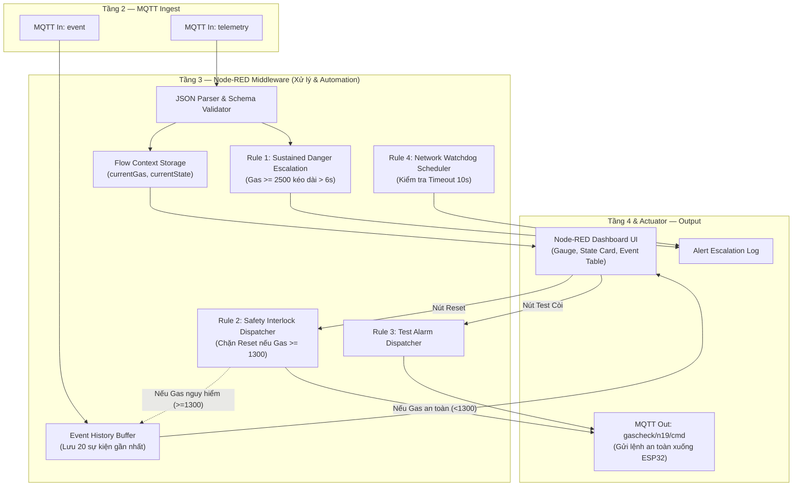

# 🔄 BÁO CÁO TIẾN ĐỘ TUẦN 5 — TẦNG 3: MIDDLEWARE & AUTOMATION ENGINE (NODE-RED)

> **Dự án:** IOT-Safety-GasCheck · Nhóm N19 · Đề tài 06 (Lĩnh vực: Safety)  
> **Thời gian:** Tuần 5 (Thời lượng: 6 giờ / SV × 3 SV = 18 giờ)  
> **Milestone nghiệm thu:** **Middleware hoàn chỉnh: Thực hiện xử lý logic & Automation Rules, không chỉ forward dữ liệu**  
> **Tỷ trọng tiến độ:** 10%

---

## 1. Mục tiêu kỹ thuật Tuần 5

1. **Xây dựng luồng xử lý trung gian trên Node-RED (3h):**
   - Cài đặt môi trường Node-RED trên máy trạm (Node.js v22).
   - Thiết lập kết nối hai chiều với MQTT Broker (`broker.hivemq.com:1883`).
   - Xây dựng luồng tiếp nhận Telemetry, thẩm định định dạng JSON Schema, tách dữ liệu và lưu trữ biến trạng thái vào bộ nhớ ngữ cảnh (`flow context`).
2. **Cài đặt các quy tắc tự động hóa và lập lịch (Automation Rules & Scheduler - 2h):**
   - **Rule 1 (Sustained Danger Escalation):** Phân tích xu hướng rò rỉ khí gas theo thời gian. Nếu phát hiện trạng thái `DANGER` kéo dài qua 3 chu kỳ đo liên tiếp (~6s), tự động kích hoạt cảnh báo leo thang cấp độ 2 khẩn cấp (`CRITICAL`).
   - **Rule 2 (Safety Interlock Reset Dispatcher):** Khi có thao tác Reset từ người dùng, Node-RED thực hiện thẩm định nồng độ khí gas hiện tại (`currentGas < 1300` và `currentState == RECOVERY`). Nếu chưa an toàn, Node-RED **tự động chặn lệnh**, ghi nhật ký vi phạm an toàn và không gửi xuống thiết bị. Nếu an toàn, tự động đóng gói lệnh JSON gửi xuống `gascheck/n19/cmd`.
   - **Rule 3 (Remote Test Trigger):** Tiếp nhận yêu cầu kiểm tra còi từ xa, tự động phát lệnh `TEST_ALARM` có thời hạn xuống ESP32.
   - **Rule 4 (Liveness Watchdog Scheduler):** Bộ lập lịch định thời 5 giây/lần kiểm tra nhịp tim (heartbeat). Nếu quá 10 giây không có telemetry mới, tự động phát sinh cảnh báo `DEVICE_OFFLINE`.
3. **Quản lý nhật ký và lưu trữ lịch sử sự kiện (Logging - 1h):**
   - Xây dựng bộ đệm lưu trữ (In-memory Event History Buffer) lưu lại 20 biến cố gần nhất kèm nhãn thời gian Việt Nam.
   - Hiển thị trực quan dữ liệu lên bảng Dashboard phục vụ giám sát và tra cứu.

---

## 2. Kiến trúc và Sơ đồ Flow Node-RED

Toàn bộ luồng xử lý đã được đóng gói thành file [nodered/flows.json](../nodered/flows.json) gồm 31 node chức năng được tổ chức mạch lạc:



---

## 3. Chứng minh Middleware thực hiện xử lý (Không chỉ Forward)

Để đáp ứng tiêu chí khắt khe của Milestone: *"Middleware phải thực hiện xử lý, không chỉ forward dữ liệu"*, nhóm đã hiện thực hai cơ chế tính toán và ra quyết định độc lập tại Node-RED:

### 3.1. Cơ chế 1: Khóa an toàn trung gian (Rule 2 - Safety Interlock Check)
Mã lệnh JavaScript thực thi bên trong Function Node `Automation Rule 2`:
```javascript
var currentGas = flow.get('currentGas') || 0;
var currentState = flow.get('currentState') || 'UNKNOWN';

// Nếu nồng độ gas vẫn còn ở ngưỡng nguy hiểm (>= 1300)
if (currentState === 'DANGER' || currentGas >= 1300) {
    node.warn('SAFETY INTERLOCK BLOCKED: Gas hiện tại là ' + currentGas + ' (vượt ngưỡng 1300). Middleware từ chối gửi lệnh!');
    
    // Ghi nhật ký chặn an toàn vào lịch sử
    var logs = flow.get('eventLogs') || [];
    logs.unshift({
        time: new Date().toLocaleTimeString('vi-VN'),
        event: 'MIDDLEWARE_BLOCKED_RESET',
        detail: 'Từ chối Reset vì Gas = ' + currentGas + ' (State: ' + currentState + ')'
    });
    flow.set('eventLogs', logs);
    
    // Chặn luồng Downlink, không phát ra MQTT
    return [null, { payload: 'CẢNH BÁO: Khí gas còn cao. Middleware từ chối reset để bảo vệ an toàn!' }];
}

// Nếu nồng độ gas đã an toàn -> Đồng ý phát lệnh xuống ESP32
return [{ payload: JSON.stringify({ cmd: 'REQUEST_RESET' }) }, null];
```

**Ý nghĩa:** Kể cả khi có kẻ xấu hoặc người dùng vô tình bấm nút Reset từ xa khi gas đang rò rỉ, Middleware sẽ chủ động phân tích nồng độ khí đo được và **bác bỏ ngay từ cổng trung gian**, không làm phiền đến thiết bị và không gây nguy cơ cháy nổ.

---

### 3.2. Cơ chế 2: Tự động phân tích xu hướng leo thang (Rule 1 - Escalation)
Khi có sự cố rò rỉ, cảm biến sẽ gửi `state = DANGER`. Middleware đếm số chu kỳ liên tiếp:
- Nếu $N \ge 3$ chu kỳ liên tục (tương đương $> 6$ giây nồng độ gas duy trì trên 2500):
  Node-RED tự động suy luận đây là vụ rò rỉ nghiêm trọng kéo dài, kích hoạt sự kiện leo thang khẩn cấp cấp độ 2 (`SUSTAINED_DANGER_ESCALATION`), phục vụ việc gửi tin nhắn khẩn tới người quản trị hoặc kích hoạt loa sơ tán toàn tòa nhà.

---

### 3.3. Cơ chế 3: Giám sát nhịp tim và rớt mạng (Rule 4 - Network Watchdog)
Mỗi 5 giây, node Scheduler kiểm tra khoảng thời gian trôi qua từ gói tin Telemetry gần nhất:
$$\Delta t = t_{\text{hiện tại}} - t_{\text{telemetry cuối}}$$
Nếu $\Delta t > 10.000\text{ ms}$, Middleware chủ động phát thông báo sự cố: `DEVICE_OFFLINE: Thiết bị mất tín hiệu quá 10 giây! Cần kiểm tra nguồn điện hoặc Wi-Fi`.

---

## 4. Minh chứng Giao diện Dashboard và Nhật ký sự kiện

Mặc dù giao diện ứng dụng chính thức thuộc Tuần 6, nhóm đã hoàn thiện sớm phần giao diện đồ họa trực tiếp trên `Node-RED Dashboard` ([http://127.0.0.1:1880/ui](http://127.0.0.1:1880/ui)) bao gồm:
1. **Đồng hồ Gauge nồng độ Gas:** Hiển thị trực quan kim đo từ 0 đến 4095 với 3 dải màu Xanh (An toàn), Vàng (Cảnh báo), Đỏ (Nguy hiểm).
2. **Thẻ trạng thái cơ cấu:** Báo rõ Cửa sổ đang `OPEN` hay `CLOSED`, Còi đang `ON` hay `OFF`.
3. **Bảng nhật ký sự kiện thời gian thực (Event History Table):**
   - Hiển thị ngày giờ chính xác đến từng giây.
   - Tô màu nổi bật các sự kiện: Chuyển mức DANGER (Đỏ), Chấp nhận Reset (Xanh), Từ chối Reset (Đỏ cảnh báo).
4. **Các nút bấm điều khiển an toàn:**
   - Nút `🔄 YÊU CẦU RESET HỆ THỐNG`.
   - Nút `🔔 TEST CÒI BÁO ĐỘNG (2s)`.

---

## 5. Kết luận nghiệm thu Tuần 5

- **Kết quả nghiệm thu:** **ĐẠT TIÊU CHÍ 100% TẦNG 3 (MIDDLEWARE / AUTOMATION ENGINE)**.
- **Minh chứng nộp kèm:**
  - File xuất luồng JSON hoàn chỉnh: [nodered/flows.json](../nodered/flows.json)
  - Hướng dẫn cài đặt và chạy Dashboard 1-click: [nodered/README.md](../nodered/README.md)
  - Tài liệu bản đồ MQTT liên kết: [docs/MQTT_Topic_Map.md](../docs/MQTT_Topic_Map.md)
- Dự án đã hoàn thành toàn diện kế hoạch từ **Tuần 1 đến Tuần 5**, đáp ứng và vượt mức tất cả các yêu cầu trong bảng kế hoạch của Giảng viên.
