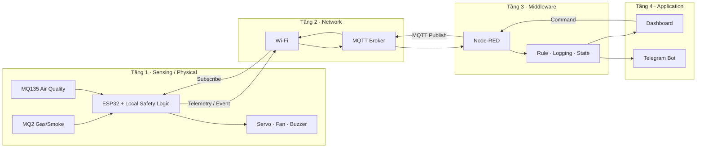

# 🛡️ IOT-Safety-GasCheck

> **Hệ thống IoT cảnh báo rò rỉ Gas & chất lượng không khí**  
> Nhóm N19 · Đề tài 06 · Nhóm ứng dụng: **Safety**

| Thông tin | Chi tiết |
|---|---|
| Thành viên | Trình Quốc An · Nguyễn Kim Long · Nguyễn Long Vỹ |
| Controller | ESP32 |
| Sensor/Input | MQ2 · MQ135 |
| Actuator | Servo mô phỏng van gas · Quạt · Buzzer |
| Giao tiếp | Wi-Fi · MQTT |
| Middleware | MQTT Broker · Node-RED |
| Application | Dashboard · Telegram Bot |
| Phương pháp | Simulation-First · Incremental Integration · State Machine · E2E Testing |

**Truy cập nhanh:** [📘 Kế hoạch chi tiết](docs/KeHoachTongThe.md) · [📅 Báo cáo Tuần 1](Bao%20cao%20hang%20tuan/Baocaodoan_Tuan01.md) · [📂 Báo cáo hằng tuần](#bao-cao-hang-tuan)

---

## Mục lục

- [1. Tổng quan](#tong-quan)
- [2. Kiến trúc IoT 4 tầng](#kien-truc)
- [3. Thành phần chính](#thanh-phan)
- [4. Luồng hoạt động](#luong-hoat-dong)
- [5. Báo cáo hằng tuần](#bao-cao-hang-tuan)
- [6. Lộ trình 10 tuần](#lo-trinh)
- [7. Phân công nhóm](#phan-cong)
- [8. Cấu trúc repository](#cau-truc-repository)
- [9. Tài liệu dự án](#tai-lieu)
- [10. Definition of Done](#definition-of-done)
- [11. Lưu ý an toàn](#luu-y-an-toan)

---

<a id="tong-quan"></a>
## 1. Tổng quan

IOT-Safety-GasCheck là hệ thống IoT mô phỏng nhằm giám sát tín hiệu liên quan đến **gas/khói** và **chất lượng không khí**, tự động phản ứng tại thiết bị khi phát hiện trạng thái nguy hiểm, đồng thời truyền dữ liệu qua MQTT để middleware xử lý, lưu log, hiển thị dashboard và gửi cảnh báo từ xa.

Mục tiêu của nhóm không chỉ là đọc cảm biến mà là chứng minh một hệ thống IoT hoàn chỉnh có **uplink, downlink, automation và application integration**. Logic an toàn quan trọng được đặt tại ESP32 để actuator vẫn phản ứng ngay cả khi Wi-Fi hoặc MQTT bị gián đoạn.

> **Baseline bắt buộc:** Simulation hoạt động + đủ 4 tầng IoT + uplink/downlink + automation + application/remote integration.

---

<a id="kien-truc"></a>
## 2. Kiến trúc IoT 4 tầng



Nguyên tắc kiến trúc quan trọng: **Safety logic nằm trên ESP32**; Node-RED đóng vai trò middleware/automation engine; application không trực tiếp override trạng thái nguy hiểm của actuator.

---

<a id="thanh-phan"></a>
## 3. Thành phần chính

| Nhóm | Thành phần | Vai trò |
|---|---|---|
| Sensing | MQ2 | Tín hiệu đại diện gas/khói |
| Sensing | MQ135 | Tín hiệu đại diện chất lượng không khí |
| Embedded | ESP32 | Đọc sensor, state machine, local safety, MQTT |
| Actuator | Servo | Mô phỏng đóng/mở van gas |
| Actuator | Fan/DC Motor | Mô phỏng thông gió |
| Actuator | Buzzer | Cảnh báo tại chỗ |
| Network | Wi-Fi + MQTT | Truyền telemetry, event, status và command |
| Middleware | Node-RED | Validate, rule, logging, alert, dashboard, command |
| Application | Dashboard | Theo dõi trạng thái và gửi lệnh |
| Application | Telegram Bot | Cảnh báo từ xa |

---

<a id="luong-hoat-dong"></a>
## 4. Luồng hoạt động

**Uplink:**

```text
MQ2 / MQ135
    ↓
ESP32
    ↓
Wi-Fi / MQTT
    ↓
MQTT Broker
    ↓
Node-RED
    ↓
Dashboard / Telegram
```

**Downlink:**

```text
Dashboard / Node-RED
    ↓
MQTT Broker
    ↓
ESP32
    ↓
Safety Validation
    ↓
Actuator
```

Khi gas đạt mức nguy hiểm, ESP32 ưu tiên đóng van mô phỏng, bật quạt và buzzer tại local. Nếu network khả dụng, event đồng thời được publish để Node-RED ghi log và gửi cảnh báo. Remote command chỉ được thực hiện sau khi ESP32 kiểm tra điều kiện an toàn.

---

<a id="bao-cao-hang-tuan"></a>
## 5. Báo cáo hằng tuần

Toàn bộ báo cáo tiến độ được lưu trong thư mục [`Bao cao hang tuan`](Bao%20cao%20hang%20tuan/). Bảng này sẽ được cập nhật xuyên suốt 10 tuần của đề tài.

| Tuần | Nội dung chính | Trạng thái | Báo cáo |
|---:|---|---|---|
| 1 | Phân tích bài toán & kiến trúc hệ thống IoT | ✅ Hoàn thành | [Xem báo cáo Tuần 1](Bao%20cao%20hang%20tuan/Baocaodoan_Tuan01.md) |
| 2 | Simulation tầng Sensing / Physical | ⏳ Chưa cập nhật | — |
| 3 | Firmware & Embedded Logic | ⏳ Chưa cập nhật | — |
| 4 | Network / MQTT | ⏳ Chưa cập nhật | — |
| 5 | Middleware / Node-RED | ⏳ Chưa cập nhật | — |
| 6 | Application / Remote Integration | ⏳ Chưa cập nhật | — |
| 7 | Automation & tình huống bất thường | ⏳ Chưa cập nhật | — |
| 8 | End-to-End Integration | ⏳ Chưa cập nhật | — |
| 9 | System Test & Documentation | ⏳ Chưa cập nhật | — |
| 10 | Final Demo & nghiệm thu | ⏳ Chưa cập nhật | — |

---

<a id="lo-trinh"></a>
## 6. Lộ trình 10 tuần

| Tuần | Trọng tâm | Milestone / Deliverable chính |
|---:|---|---|
| W1 | Phân tích yêu cầu & thiết kế | Problem Statement, Use Case, BOM, Architecture V1, State Machine, MQTT draft |
| W2 | Simulation Sensing / Physical | Circuit, sensor → actuator, simulation V1 |
| W3 | Firmware & Embedded Logic | Filtering, hysteresis, state machine, calibration note |
| W4 | Network / MQTT | Publish, subscribe, payload, reconnect, uplink/downlink |
| W5 | Node-RED | Telemetry flow, event flow, logging, automation |
| W6 | Application | Dashboard, Telegram, remote command, full 4-layer evidence |
| W7 | Safety Automation | Rules, recovery, safety interlock, abnormal scenario |
| W8 | E2E Integration | Full uplink/downlink, regression test, bug fixing |
| W9 | System Test | Test report, final architecture, documentation, video draft |
| W10 | Final Demo | Live demo, report, video, slide/poster, Q&A |

Chi tiết đầy đủ về từng tuần, test case, MQTT topics, state machine và rubric được lưu tại **[Kế hoạch thực hiện tổng thể](docs/KeHoachTongThe.md)**.

---

<a id="phan-cong"></a>
## 7. Phân công nhóm

| Thành viên | Vai trò chính | Phạm vi phụ trách |
|---|---|---|
| **Trình Quốc An** | Sensing / Embedded | Simulation, circuit, MQ2/MQ135, actuator, firmware, state machine |
| **Nguyễn Kim Long** | Network / Middleware | Wi-Fi, MQTT, broker, topic/payload, Node-RED, logging/rule |
| **Nguyễn Long Vỹ** | Application / Automation | Dashboard, Telegram, remote command, automation/business rules |

Mỗi thành viên vẫn phải cross-review và giải thích được toàn bộ luồng end-to-end của hệ thống.

---

<a id="cau-truc-repository"></a>
## 8. Cấu trúc repository

```text
IOT_Safety_GasCheck/
│
├── Bao cao hang tuan/
│   └── Baocaodoan_Tuan01.md
│
├── docs/
│   └── KeHoachTongThe.md
│
├── esp32/                 # Firmware ESP32 (dự kiến)
├── simulation/            # Wokwi / simulation assets (dự kiến)
├── node-red/              # Node-RED flows (dự kiến)
├── telegram/              # Telegram integration docs (dự kiến)
├── evidence/              # Evidence theo milestone (dự kiến)
├── slides/                # Slide/poster cuối kỳ (dự kiến)
│
└── README.md
```

Thư mục sẽ được mở rộng dần theo tiến độ từng tuần; không tạo trước các thư mục rỗng chỉ để khớp cấu trúc.

---

<a id="tai-lieu"></a>
## 9. Tài liệu dự án

| Tài liệu | Nội dung |
|---|---|
| [Kế hoạch thực hiện tổng thể](docs/KeHoachTongThe.md) | Kế hoạch chi tiết 10 tuần, kiến trúc, MQTT, state machine, test, rubric và deliverables |
| [Báo cáo Tuần 1](Bao%20cao%20hang%20tuan/Baocaodoan_Tuan01.md) | Phân tích bài toán, use case, yêu cầu, architecture V1, BOM, test scenarios và phân công |

Các báo cáo mới sẽ được bổ sung vào mục **Báo cáo hằng tuần** ngay khi hoàn thành từng milestone.

---

<a id="definition-of-done"></a>
## 10. Definition of Done

Đề tài được xem là hoàn thành khi chứng minh được các thành phần chính sau:

- [ ] Simulation sensor/input thay đổi và actuator phản ứng đúng.
- [ ] ESP32 có filtering, state machine và local safety logic.
- [ ] MQTT publish, subscribe và reconnect hoạt động.
- [ ] Node-RED nhận dữ liệu, xử lý rule, logging và command.
- [ ] Dashboard hiển thị realtime và có remote interaction.
- [ ] Telegram hoặc cơ chế tương đương gửi cảnh báo từ xa.
- [ ] Safety interlock ngăn command nguy hiểm.
- [ ] Uplink và downlink hoạt động end-to-end.
- [ ] Có test report, source, architecture, wiring, MQTT docs, video và báo cáo cuối kỳ.

---

<a id="luu-y-an-toan"></a>
## 11. Lưu ý an toàn

> Dự án này là **prototype/mô phỏng phục vụ học tập**. MQ2/MQ135, servo và mạch tự lắp không phải hệ thống phát hiện/rò rỉ gas được chứng nhận và không nên được dùng để bảo vệ người hoặc tài sản trong hệ thống gas thực tế.

Nếu triển khai hardware bonus, servo chỉ nên mô phỏng cơ cấu van. Không gắn trực tiếp cơ cấu tự chế vào đường gas đang sử dụng.

---

**Project:** IOT-Safety-GasCheck · **Nhóm:** N19 · **Phương châm triển khai:** `Simulation-First → Incremental Integration → State-Machine Automation → End-to-End Testing`
