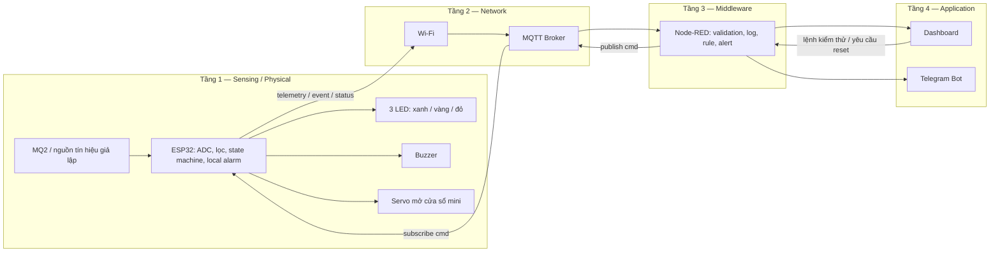
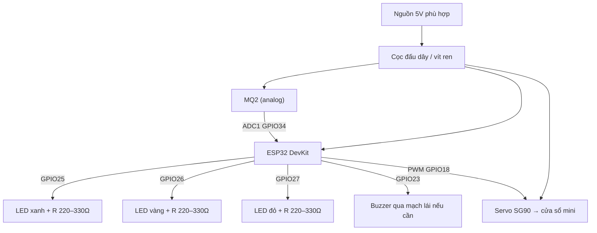

# 🛡️ IOT-Safety-GasCheck

> **GasCheck V2 — Mô hình IoT phát hiện và cảnh báo rò rỉ khí gas, mô phỏng mở cửa sổ tự động**  
> Nhóm N19 · Đề tài 06 · Safety · **Thiết kế vật lý cập nhật: 17/10/2026**

## Mục lục

- [1. Tổng quan và phạm vi](#tong-quan)
- [2. Kiến trúc 4 tầng](#kien-truc)
- [3. Mô hình vật lý và BOM](#mo-hinh-vat-ly)
- [4. Nguyên lý hoạt động](#nguyen-ly)
- [5. Giao tiếp MQTT và ứng dụng](#mqtt)
- [6. Lộ trình và phân công](#lo-trinh)
- [7. Tài liệu và báo cáo](#tai-lieu)
- [8. Trạng thái triển khai](#trang-thai)
- [9. Giới hạn an toàn](#an-toan)

<a id="tong-quan"></a>
## 1. Tổng quan và phạm vi

Dự án xây dựng mô hình học tập dùng **MQ2** phát hiện tín hiệu liên quan khí gas, **ESP32** phân mức trạng thái và điều khiển **03 LED, buzzer, servo mở cửa sổ mini**. Thiết bị vẫn cảnh báo cục bộ ngay cả khi mất Wi-Fi/MQTT. Dữ liệu sau đó có thể đi qua **Wi-Fi → MQTT Broker → Node-RED → Dashboard/Telegram** để giám sát và thông báo từ xa.

**Bài toán thực tế:** rò rỉ có thể ở van, cổ bình, thân bình, ống dẫn, khớp nối hoặc thiết bị sử dụng gas. Do đó **không giả định đóng van là giải pháp cho mọi vị trí rò rỉ**. Servo của đồ án **chỉ mô phỏng mở cửa sổ nhỏ**, không điều khiển van gas.

> **Thay đổi so với thiết kế V1:** bỏ MQ135 khỏi cấu hình phần cứng hiện tại; bỏ quạt; bỏ relay không còn tải sử dụng; đổi servo từ mô phỏng van sang mô phỏng cửa sổ; dùng 3 LED cố định. Tên đề tài được giao ban đầu có cụm “& chất lượng không khí”; nhóm cần xác nhận với giảng viên về việc thu hẹp phạm vi nếu MQ135 là tiêu chí bắt buộc.

<a id="kien-truc"></a>
## 2. Kiến trúc IoT 4 tầng



**Safety rule cục bộ nằm ở ESP32**: đường truyền mạng không phải điều kiện để phát còi hoặc thay đổi LED. Node-RED và Dashboard không được gửi lệnh làm tắt cảnh báo nguy hiểm khi cảm biến vẫn báo mức nguy hiểm.

<a id="mo-hinh-vat-ly"></a>
## 3. Mô hình vật lý và BOM



| Thiết bị | Số lượng | Vai trò |
|---|---:|---|
| ESP32 DevKit | 1 | Xử lý và kết nối Wi-Fi/MQTT |
| MQ2 module | 1 | Đầu vào phát hiện khí gas/khói (không đo chính xác ppm nếu chưa hiệu chuẩn) |
| Servo mini (ví dụ SG90) | 1 | Mở cửa sổ **trong sa bàn** |
| Buzzer | 1 | Cảnh báo âm thanh |
| LED xanh, vàng, đỏ | 1 mỗi loại | Mức bình thường, cảnh báo, nguy hiểm |
| Điện trở LED 220–330Ω | 3 | Hạn dòng LED |
| Dây nối và cọc đấu dây vít ren | 1 bộ | Kết nối và phân phối nguồn gọn |
| Nguồn 5V đủ dòng / cáp USB | Theo mạch | Cấp nguồn phù hợp |
| Mạch chia áp bảo vệ ADC / mạch lái buzzer | Khi cần | Tương thích điện áp và dòng điện |

**Không sử dụng trong V2:** MQ135, quạt thông gió, relay và servo đóng van gas.

Sơ đồ GPIO là **đề xuất để triển khai**, chưa xác nhận trên mạch thật. Chi tiết nguồn, mass chung, giới hạn ADC 3,3V và kiểm tra mạch xem [Pinout V2](docs/wiring/Pinout_V2.md). Cọc đấu dây không tự động biến mạch điện thành thiết bị chống cháy nổ.

<a id="nguyen-ly"></a>
## 4. Nguyên lý hoạt động

| Trạng thái | Đèn báo | Buzzer | Servo cửa sổ (demo) |
|---|---|---|---|
| `NORMAL` | Xanh | Tắt | Đóng |
| `WARNING` | Vàng | Kêu ngắt quãng | Giữ vị trí đóng |
| `DANGER` | Đỏ | Kêu liên tục | Mở |
| `RECOVERY` | Vàng nhấp nháy | Theo chính sách cảnh báo chờ xác nhận | Giữ mở |
| `FAULT` | Đỏ nhấp nháy | Mẫu báo lỗi riêng | Không ra lệnh tự đóng khi đang cảnh báo |

- ESP32 đọc MQ2 qua ADC1, lọc nhiễu và so sánh **ngưỡng thử nghiệm**; ngưỡng ADC mô phỏng **không phải ngưỡng nồng độ gas an toàn thực tế**.
- Sử dụng hysteresis/debounce để tránh đảo trạng thái liên tục.
- Khi vào `DANGER`, ưu tiên còi và LED; servo mô phỏng mở cửa sổ mini. Khi tín hiệu giảm, vào `RECOVERY`; chỉ về `NORMAL` sau khi giá trị ổn định và có xác nhận/reset theo thiết kế.
- Mất Wi-Fi/MQTT: cảnh báo tại ESP32 vẫn hoạt động; gửi lại trạng thái mới khi mạng phục hồi.
- Lỗi cảm biến: hiển thị `FAULT`, không mặc định coi mất tín hiệu là an toàn.

<a id="mqtt"></a>
## 5. Giao tiếp MQTT và ứng dụng (kế hoạch)

| Topic | Hướng | Dữ liệu |
|---|---|---|
| `gascheck/n19/telemetry` | ESP32 → Broker | `gas_raw`, `state`, `window`, `buzzer` |
| `gascheck/n19/event` | ESP32 → Broker | Sự kiện chuyển trạng thái, cảnh báo |
| `gascheck/n19/status` | ESP32 → Broker | Online/offline, trạng thái đầu ra, lỗi |
| `gascheck/n19/cmd` | Node-RED → ESP32 | `REQUEST_RESET`, `TEST_ALARM` có kiểm tra điều kiện |

Payload mẫu:

```json
{
  "device_id": "n19-gascheck-01",
  "gas_raw": 1200,
  "state": "NORMAL",
  "window": "CLOSED",
  "buzzer": false,
  "led": "GREEN"
}
```

Các topic và lệnh đang ở mức **đặc tả**, chưa khẳng định đã triển khai phần mềm.

<a id="lo-trinh"></a>
## 6. Lộ trình và phân công

| Tuần | Trọng tâm |
|---|---|
| 1 | Phân tích yêu cầu, kiến trúc, BOM; cập nhật thay đổi sang V2 |
| 2 | Simulation MQ2 → ESP32 → LED/buzzer/servo mở cửa sổ |
| 3 | Firmware: lọc, state machine, lỗi đầu vào, reset |
| 4 | Wi-Fi/MQTT, uplink/downlink, reconnect |
| 5 | Node-RED, log, automation |
| 6 | Dashboard và Telegram |
| 7 | Kiểm thử mất mạng, lỗi cảm biến, an toàn command |
| 8 | Tích hợp E2E |
| 9 | Test report, wiring, minh chứng |
| 10 | Demo và nghiệm thu |

| Thành viên | Phụ trách |
|---|---|
| Trình Quốc An | Sensing / Embedded — mạch, MQ2, servo cửa sổ, LED, buzzer, firmware |
| Nguyễn Kim Long | Network / Middleware — MQTT, Node-RED, tích hợp |
| Nguyễn Long Vỹ | Application / Automation — Dashboard, Telegram, QA |

<a id="tai-lieu"></a>
## 7. Tài liệu và báo cáo

| Tài liệu | Mục đích |
|---|---|
| [Thiết kế vật lý & kiến trúc GasCheck V2](docs/KienTrucVatLy_GasCheck_V2.md) | **Nguồn tham chiếu hiện hành** cho phần cứng, an toàn, trạng thái và 4 tầng |
| [Sơ đồ chân đề xuất V2](docs/wiring/Pinout_V2.md) | GPIO, nguồn và kiểm tra điện |
| [Kế hoạch Tuần 2 — V2](docs/KeHoachTuan02.md) | Việc cần làm và test case phiên bản mới |
| [Kế hoạch tổng thể — baseline V1](docs/KeHoachTongThe.md) | Tài liệu kế hoạch gốc; phần linh kiện/logic V1 đã được thay thế |
| [Báo cáo Tuần 1 — baseline V1](Bao%20cao%20hang%20tuan/Baocaodoan_Tuan01.md) | Bằng chứng thiết kế gốc, giữ lịch sử |
| [Thư mục báo cáo hằng tuần](Bao%20cao%20hang%20tuan/) | Các báo cáo theo từng milestone |

<a id="trang-thai"></a>
## 8. Trạng thái triển khai

- [x] Chốt thay đổi kiến trúc vật lý V2 và bổ sung tài liệu GitHub.
- [ ] Xác nhận phạm vi rút MQ135 với giảng viên nếu tiêu chí đề tài yêu cầu chất lượng không khí.
- [ ] Mạch Wokwi/sa bàn thực tế hoạt động.
- [ ] Firmware và test các trạng thái.
- [ ] MQTT Broker, Node-RED, Dashboard, Telegram chạy end-to-end.
- [ ] Kiểm thử tình huống bất thường và nghiệm thu.

<a id="an-toan"></a>
## 9. Giới hạn an toàn

> **Prototype phục vụ học tập, KHÔNG phải hệ thống bảo vệ an toàn gas đã chứng nhận.** Không dùng khí gas thật để tạo tình huống rò rỉ khi demo; dùng potentiometer hoặc tín hiệu giả lập. MQ2/ESP32, buzzer, servo, cọc đấu dây tự lắp không được xem là thiết bị an toàn trong môi trường có khí dễ cháy. Servo motor có thể là nguồn đánh lửa; cơ cấu mở cửa sổ bằng servo chỉ phù hợp cho sa bàn không có gas thật. Trong một hệ thống thực tế cần giải pháp phát hiện và ứng phó được đánh giá/chứng nhận phù hợp, không được mặc định bật động cơ hay đóng/ngắt điện khi có rò rỉ.

**Phương pháp triển khai:** Simulation-First → Local Logic → MQTT/Node-RED → Application → E2E Testing.
