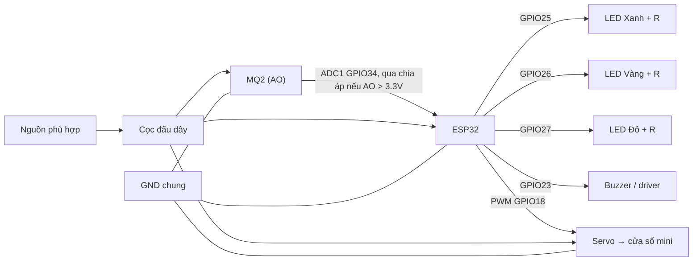
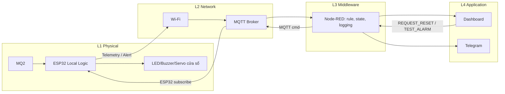

# GasCheck V2 — Thiết kế vật lý và kiến trúc IoT

> **Trạng thái:** bản thiết kế hiện hành (17/10/2026).  
> **Phạm vi:** đồ án/mô hình mô phỏng không sử dụng khí gas thật.  
> **Thay thế:** các mục thành phần vật lý, state và actuator của [kế hoạch V1](KeHoachTongThe.md) và [báo cáo Tuần 1](../Bao%20cao%20hang%20tuan/Baocaodoan_Tuan01.md). Giữ V1 để đối chiếu lịch sử.

## 1. Quyết định thay đổi (V1 → V2)

| Hạng mục | V1 | V2 hiện hành | Lý do |
|---|---|---|---|
| Cảm biến | MQ2 + MQ135 | **MQ2** | Tập trung phát hiện tín hiệu rò rỉ gas |
| Cơ cấu servo | Mô phỏng đóng van gas | **Mở cửa sổ sa bàn** | Rò rỉ có thể ở thân/cổ bình, không chỉ phía sau van |
| Thông gió | Quạt qua relay | **Không dùng quạt** | Tránh minh họa việc khởi động thiết bị điện thường trong môi trường gas |
| Relay | Điều khiển quạt | **Bỏ** | Không có tải cần relay |
| Cảnh báo | Buzzer + LED tùy chọn | **Buzzer + 3 LED bắt buộc** | Nhận biết 3 mức rõ ràng |
| Đi dây | Chưa chốt | **Dây nối + cọc đấu dây vít ren** | Tăng tính gọn gàng khi dựng sa bàn |

**Quan trọng về phạm vi:** tên đề tài được giao ban đầu bao gồm “chất lượng không khí”. Nếu MQ135 là bắt buộc theo rubric/đề bài, việc thu hẹp cần được giảng viên đồng ý; chưa nên tuyên bố đáp ứng đầy đủ hạng mục này.

## 2. Phân tích bài toán

Rò rỉ gas không giới hạn ở van: có thể từ thân bình, cổ bình, gioăng, ống, mối nối, bếp hoặc thiết bị chứa gas. Việc đóng một van ở sai vị trí **không bảo đảm** ngăn rò rỉ. Mục tiêu V2 vì vậy là:

1. Phát hiện bất thường của tín hiệu MQ2 trong vùng giám sát.
2. Phân mức `NORMAL`, `WARNING`, `DANGER`; phát tín hiệu cảnh báo **tại chỗ**.
3. Mô phỏng mở cửa sổ mini bằng servo để minh họa cơ cấu thông thoáng, **không coi là biện pháp xử lý an toàn đã được kiểm định**.
4. Gửi telemetry, sự kiện và trạng thái qua MQTT đến Node-RED; hiển thị Dashboard, gửi Telegram khi mạng khả dụng.
5. Phát hiện lỗi cảm biến/mạng, khôi phục có kiểm soát, lưu log phục vụ demo.

Không nằm trong phạm vi: xác định chính xác nguồn rò rỉ, xác định nồng độ ppm đạt chuẩn đo lường, chế tạo thiết bị bảo vệ đường gas thật hoặc bảo đảm loại bỏ khí gas nhờ mở cửa sổ.

## 3. Danh mục vật lý (BOM V2)

| STT | Thành phần | SL | Chức năng | Ghi chú |
|---:|---|---:|---|---|
| 1 | ESP32 DevKit | 1 | Đọc ADC, xử lý trạng thái, Wi-Fi | Vi điều khiển trung tâm |
| 2 | Cảm biến MQ2 module | 1 | Đọc tín hiệu gas/khói | Module có thể hoạt động ở 5V |
| 3 | Servo mini SG90 hoặc tương đương | 1 | Mở/đóng cửa sổ mô hình | **Không dùng cạnh rò rỉ gas thật** |
| 4 | Buzzer phù hợp | 1 | Báo động âm thanh | Chọn mạch lái theo dòng tiêu thụ |
| 5 | LED xanh, vàng, đỏ | 1 mỗi màu | Báo 3 mức chính | Cần điện trở riêng |
| 6 | Điện trở hạn dòng 220–330Ω | 3 | Bảo vệ LED | Tùy điện áp, LED |
| 7 | Dây nối | 1 bộ | Kết nối tín hiệu và nguồn | Không dùng đầu nối lỏng lẻo |
| 8 | Cọc đấu dây vít ren | 1 bộ | Nối dây phân phối nguồn | Không phải linh kiện chống cháy nổ |
| 9 | Nguồn 5V và cáp phù hợp | Theo tải | Nuôi ESP32, servo và module | Cần dự trù dòng đỉnh của servo |
| 10 | Chia áp AO MQ2, mạch lái buzzer (nếu cần) | Theo phần cứng | Giới hạn điện áp/dòng | Kiểm tra module cụ thể trước khi nối |

**Bỏ hoàn toàn khỏi BOM đang triển khai:** MQ135, quạt, relay/driver quạt, servo điều khiển van.

## 4. Bố trí vật lý sa bàn

- **Khu vực bếp/bình gas giả:** hình minh họa (không chứa hay xả gas thật); đặt MQ2 tại vị trí dễ nhìn, trên đế cố định.
- **Cửa sổ mini:** cơ cấu nhẹ, có khớp bản lề và thanh truyền nối với servo; có chặn hành trình cơ khí để servo không bị kẹt.
- **Bảng điều khiển:** ESP32, buzzer và 3 LED ở phía trước; hộp che bảo vệ các điểm đấu điện.
- **Cọc đấu dây vít ren:** chỉ làm điểm nối nguồn, đi dây ngắn, đánh dấu VCC/GND/tín hiệu.
- **Nguồn điện:** ổn định; cấp servo bằng nguồn 5V đủ dòng, nối chung GND với ESP32; không kéo dòng động cơ trực tiếp từ GPIO.

Vị trí đặt đầu dò cho **thiết bị thực tế** còn phụ thuộc loại gas: LPG thường tích tụ thấp, methane có xu hướng tích tụ phía trên. Tuy nhiên mô hình MQ2 không thay thế việc lựa chọn đầu báo đạt chuẩn và lắp đặt theo tài liệu hãng.

## 5. Sơ đồ vật lý logic



**Đây là sơ đồ khối kết nối, không phải sơ đồ điện thi công**. Xem [Pinout V2](wiring/Pinout_V2.md) để kiểm tra điện áp, mạch chia áp, mass và dòng tải.

## 6. Quy ước trạng thái và phản ứng (V2)

| State | Điều kiện biểu diễn | LED | Buzzer | Cửa sổ mini |
|---|---|---|---|---|
| `NORMAL` | Tín hiệu MQ2 bình thường | Xanh | OFF | CLOSED |
| `WARNING` | Tín hiệu MQ2 vượt ngưỡng cảnh báo | Vàng | Kêu ngắt quãng | CLOSED |
| `DANGER` | Tín hiệu MQ2 vượt ngưỡng nguy hiểm | Đỏ | Kêu liên tục | OPEN |
| `RECOVERY` | Gas giảm, chờ xác nhận | Vàng nhấp nháy | Tùy chính sách ACK, không im lặng như bình thường | OPEN |
| `FAULT` | Lỗi cảm biến/đo, phát hiện bất thường | Đỏ nhấp nháy | Mẫu báo lỗi | Không cưỡng bức đóng cửa sổ khi chưa xác minh |

**Priority:** `FAULT` và `DANGER` là các tình huống không được coi là `NORMAL`; trong demo có thể ưu tiên `DANGER` khi tín hiệu nguy hiểm còn hợp lệ, đồng thời gửi cờ lỗi riêng.

- **Debounce/hysteresis:** ngưỡng cảnh báo và ngưỡng thoát cảnh báo tách biệt, tránh dao động bật/tắt.
- **Latch nguy hiểm:** Khi `DANGER` xảy ra, lưu sự kiện; chuyển `RECOVERY` khi giá trị đã hạ và ổn định.
- **Reset có điều kiện:** chỉ cho về `NORMAL` khi dữ liệu hợp lệ, ổn định và người dùng xác nhận; trong demo servo mới quay về đóng.
- **Không override an toàn:** Lệnh từ mạng không được tắt còi hay đóng cửa sổ trong `DANGER` chỉ vì người dùng bấm nút trên Dashboard.
- **Giới hạn phát hiện lỗi:** MQ2 đơn lẻ không bảo đảm nhận ra mọi kiểu lỗi; các kiểm tra (ADC rail, mất mẫu, lỗi nguồn, boot) chỉ là heuristic cần test riêng.

Ngưỡng thô ví dụ trong **Wokwi**: `WARNING >= 1500`, `DANGER >= 2500` trên dải ADC 0–4095, chỉ dùng kiểm thử luồng điều khiển, **không suy ra ppm hay mức cháy nổ thực**.

## 7. Kiến trúc 4 tầng giữ nguyên



**Uplink:** MQ2 → ESP32 → Wi-Fi → MQTT Broker → Node-RED → Dashboard/Telegram.  
**Downlink:** Dashboard/Node-RED → MQTT Broker → ESP32 → kiểm tra trạng thái → hành động được phép.

## 8. MQTT Draft V2

Topics:

- `gascheck/n19/telemetry`: gas raw/filter, state, trạng thái actuator; QoS 0 khi phù hợp.
- `gascheck/n19/event`: cảnh báo và transition có id/timestamp; cân nhắc QoS 1.
- `gascheck/n19/status`: online/offline, thông tin thiết bị, fault, trạng thái window.
- `gascheck/n19/cmd`: lệnh test/reset có xác thực và điều kiện an toàn. Không thiết kế lệnh "force safe".

```json
{
  "device_id": "n19-gascheck-01",
  "gas_raw": 1860,
  "state": "WARNING",
  "led": "YELLOW",
  "buzzer": true,
  "window": "CLOSED",
  "sensor_fault": false
}
```

Node-RED xử lý log/chống spam/cảnh báo từ xa, **không giành quyền kiểm soát local alarm của ESP32**.

## 9. Kiểm thử và tiêu chí nghiệm thu

| ID | Kịch bản | Kết quả mong đợi |
|---|---|---|
| TC01 | ADC thấp/normal | LED xanh, buzzer OFF, cửa sổ đóng |
| TC02 | ADC lên warning | LED vàng, buzzer ngắt quãng, servo giữ đóng |
| TC03 | ADC lên danger | LED đỏ, buzzer liên tục, servo mở cửa sổ |
| TC04 | ADC giảm ngắn rồi tăng lại | Không dao động nhiều do hysteresis/debounce |
| TC05 | Từ danger giảm ổn định | RECOVERY, cửa sổ giữ mở tới reset hợp lệ |
| TC06 | Reset khi còn danger | Từ chối, giữ cảnh báo |
| TC07 | Reset sau phục hồi ổn định | NORMAL, servo đóng trong demo |
| TC08 | Mất Wi-Fi/MQTT trong danger | Local alarm vẫn chạy |
| TC09 | Mạng hoạt động trở lại | Publish trạng thái mới; Node-RED nhận event/status |
| TC10 | Lỗi đầu vào hoặc mạch giả lập | Hiển thị FAULT và log lỗi, không hiển thị NORMAL |

Bằng chứng cần lưu: schematic/diagram, Serial JSON, log MQTT, flow Node-RED, dashboard, Telegram, video test thực tế *không dùng gas thật*, kết quả test có pass/fail.

## 10. Giới hạn an toàn bắt buộc

1. **Không xả gas thật để thử mô hình.** Dùng potentiometer/input mô phỏng ADC.
2. Servo SG90, buzzer, relay phổ thông, MQ2 module, cọc đấu dây và ESP32 **không phải thiết bị được chứng nhận an toàn trong môi trường có khí dễ cháy**. Đặc biệt, servo motor có thể phát sinh nguồn đánh lửa.
3. **Không biến cửa sổ servo thành cam kết an toàn.** Mở cửa có thể hỗ trợ thông thoáng, nhưng không loại bỏ nguồn rò và không chứng minh được nồng độ đã an toàn.
4. Nếu cần bảo vệ công trình thật, dùng thiết bị phát hiện gas/thiết bị chấp hành phù hợp và thiết kế lắp đặt bởi đơn vị chuyên môn; có cảnh báo, sơ tán, loại trừ nguồn đánh lửa theo quy trình thực tế.
5. Thử mạch riêng với nguồn đúng chuẩn, hạn dòng LED, bảo vệ ADC 3,3V. Ngừng cấp nguồn khi có nóng bất thường hoặc sự cố.
