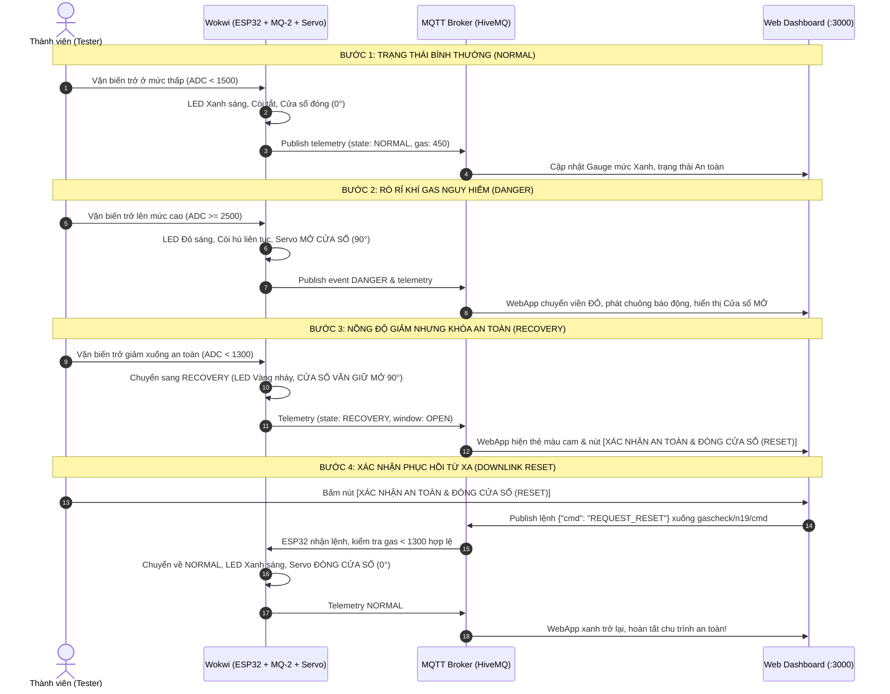

# 🚀 HƯỚNG DẪN TRIỂN KHAI & SỬ DỤNG DỰ ÁN GASCHECK V2 DÀNH CHO NHÓM N19

> **Dành cho:** Tất cả thành viên trong nhóm N19 (Trình Quốc An, Nguyễn Kim Long, Nguyễn Long Vỹ) hoặc bất kỳ ai muốn chạy thử nghiệm toàn bộ hệ thống IoT GasCheck V2 từ A đến Z trên máy tính cá nhân.  
> **Không cần phần cứng vật lý:** Toàn bộ hệ thống chạy mô phỏng 100% qua Wokwi, kết nối Internet thực qua MQTT Broker công cộng và đồng bộ trực tiếp lên Web App / Node-RED Dashboard.

---

## 📋 Mục lục
1. [Yêu cầu môi trường & Tải mã nguồn](#1-cai-dat-moi-truong)
2. [Tầng 1 & 2: Chạy ESP32 trên Wokwi (Cảm biến & MQTT)](#2-chay-wokwi)
3. [Tầng 2: Giám sát & Bắn lệnh qua MQTTX (Network Testing)](#3-giam-sat-mqttx)
4. [Tầng 4: Chạy Web Dashboard thời gian thực (React + Express)](#4-chay-webapp)
5. [Tầng 3: Chạy Middleware Node-RED (Tùy chọn)](#5-chay-nodered)
6. [Kịch bản phối hợp kiểm thử toàn diện (E2E Walkthrough)](#6-kich-ban-demo)

---

<a id="1-cai-dat-moi-truong"></a>
## 1. Yêu cầu môi trường & Tải mã nguồn

### Yêu cầu trên máy tính thành viên:
- **Git** đã cài đặt.
- **Node.js** (Khuyến nghị phiên bản v18, v20 hoặc v22).
- Trình duyệt Web (Google Chrome, Microsoft Edge, Brave,...).

### Tải dự án về máy:
Mở Terminal / PowerShell và chạy:
```bash
git clone https://github.com/klongnguyen/IOT_Safety_GasCheck.git
cd IOT_Safety_GasCheck
```

---

<a id="2-chay-wokwi"></a>
## 2. Tầng 1 & 2: Chạy ESP32 trên Wokwi (Cảm biến & MQTT)

Wokwi mô phỏng toàn bộ vi điều khiển ESP32, biến trở mô phỏng MQ-2, 3 LED cảnh báo, còi buzzer và servo mở cửa sổ mini SG90.

### Các bước thực hiện:
1. Mở trình duyệt, truy cập: **[https://wokwi.com/projects/new/esp32](https://wokwi.com/projects/new/esp32)**
2. **Nạp sơ đồ mạch (diagram.json):**
   - Bấm vào tab `diagram.json` trên Wokwi.
   - Mở file [simulation/diagram.json](../simulation/diagram.json) trong dự án, copy toàn bộ nội dung và dán đè vào.
   - Bạn sẽ thấy bo mạch ESP32 cùng đầy đủ linh kiện V2 hiện ra.
3. **Cài đặt thư viện:**
   - Bấm vào tab **Library Manager** (biểu tượng cuốn sách hoặc file `libraries.txt`).
   - Thêm 3 thư viện:
     ```text
     ESP32Servo
     PubSubClient
     ArduinoJson
     ```
4. **Nạp mã nguồn firmware:**
   - Bấm vào tab `sketch.ino`.
   - Mở file [simulation/sketch.ino](../simulation/sketch.ino) trong dự án, copy toàn bộ và dán đè vào.
5. **Bấm nút Play (Start Simulation) màu xanh lá.**

### Dấu hiệu thành công trong ô Serial Monitor:
```text
[BOOT] Khoi tao phan cung GasCheck V2...
[WIFI] Dang ket noi Wi-Fi 'Wokwi-GUEST'...
[WIFI] Da ket noi! IP: 10.0.1.2
[MQTT] Ket noi Broker broker.hivemq.com:1883...
[MQTT] Ket noi thanh cong!
[MQTT-UPLINK] Telemetry -> {"device_id":"n19-gascheck-01","state":"NORMAL",...}
```

---

<a id="3-giam-sat-mqttx"></a>
## 3. Tầng 2: Giám sát & Bắn lệnh qua MQTTX (Network Testing)

Dành cho thành viên phụ trách mạng/kiểm thử muốn soi từng gói tin MQTT:

1. Tải và cài đặt **[MQTTX](https://mqttx.app/)** hoặc dùng bản web **[MQTTX Web](https://mqttx.app/web)**.
2. Tạo kết nối mới (New Connection):
   - **Name:** `GasCheck_Test`
   - **Host:** `broker.hivemq.com`
   - **Port:** `1883` (hoặc `8884` nếu dùng Web WSS)
   - Bấm **Connect**.
3. **Đăng ký nhận tin (Subscribe):**
   - Topic: `gascheck/n19/#` (để nhận toàn bộ Telemetry, Event, Status)
4. **Bắn lệnh Downlink mô phỏng (Publish):**
   - Topic: `gascheck/n19/cmd`
   - Payload JSON:
     ```json
     {
       "cmd": "REQUEST_RESET"
     }
     ```
   - Quan sát trên Serial Monitor của Wokwi: ESP32 sẽ nhận lệnh và ghi log xử lý an toàn!

---

<a id="4-chay-webapp"></a>
## 4. Tầng 4: Chạy Web Dashboard thời gian thực (React + Express)

Giao diện Web chuyên nghiệp giúp cả nhóm xem đồng hồ đo gas thời gian thực, trạng thái các linh kiện và bấm nút Xác nhận phục hồi an toàn.

### Các bước khởi động Web App:
1. Mở cửa sổ Terminal tại thư mục gốc của dự án:
   ```bash
   cd webapp
   ```
2. **Tạo file cấu hình môi trường `.env`:**
   Copy từ mẫu `.env.example`:
   ```bash
   # Trên Windows PowerShell:
   Copy-Item .env.example .env

   # Hoặc trên Linux/macOS/Git Bash:
   cp .env.example .env
   ```
   *(File `.env` mặc định đã trỏ sẵn vào Broker `broker.hivemq.com` đồng bộ 100% với Wokwi)*.

3. **Cài đặt thư viện phụ thuộc:**
   ```bash
   npm install --legacy-peer-deps
   ```

4. **Khởi động ứng dụng:**
   ```bash
   npm run dev
   ```

5. **Mở trình duyệt:** Truy cập **`http://localhost:3000`**.
   - Bảng điều khiển sẽ hiển thị trạng thái `LIVE`, biểu tượng broker xanh lá và nhận telemetry từ Wokwi mỗi 2 giây!

---

<a id="5-chay-nodered"></a>
## 5. Tầng 3: Chạy Middleware Node-RED (Tùy chọn)

Nếu muốn kiểm tra luồng tự động hóa, lọc dữ liệu và chặn lệnh nguy hiểm (Safety Interlock):

1. Cài đặt Node-RED:
   ```bash
   npm install -g --unsafe-perm node-red
   ```
2. Cài dashboard:
   Mở `http://127.0.0.1:1880` → Menu (☰) → **Manage palette** → Install: `node-red-dashboard`.
3. Import Flow:
   - Menu (☰) → **Import** → chọn file [nodered/flows.json](../nodered/flows.json).
   - Bấm **Deploy**.
4. Truy cập giao diện Node-RED Dashboard: **`http://127.0.0.1:1880/ui`**.

---

<a id="6-kich-ban-demo"></a>
## 6. Kịch bản phối hợp kiểm thử toàn diện (E2E Walkthrough)

Đây là quy trình mẫu để cả nhóm cùng kiểm thử hoặc quay video báo cáo:



---

## 📞 Hỗ trợ nhanh khi gặp lỗi:
- **Lỗi Wokwi báo `WiFi Disconnected` hoặc `MQTT Timeout`:** Bấm nút Restart Simulator trong Wokwi (icon vòng cung xoay lại).
- **Lỗi WebApp không kết nối được:** Kiểm tra file `webapp/.env` đã tạo chưa và đảm bảo cổng 3000 không bị phần mềm khác chiếm dụng.
- **Lỗi `npm install` xung đột dependencies:** Luôn dùng cờ `--legacy-peer-deps` khi cài đặt `webapp`:
  ```bash
  npm install --legacy-peer-deps
  ```
